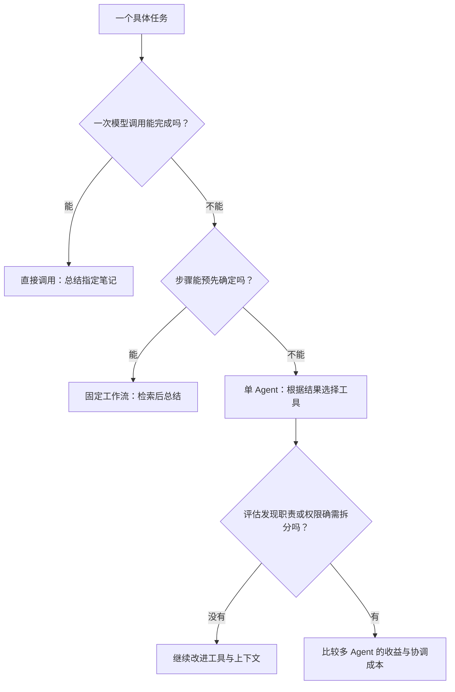

# 00. 你已有的能力与要补的知识

## 为什么会调用 API，还需要学 Agent？

想象你管理一间小图书室。有人问：“事务和重试有什么关系？”

你可以把一本书递给一个擅长解释的值班员，请他总结。这像一次模型调用：你把资料准备好，模型生成答案。

如果你希望他先找书、比较几页内容，再回答，就需要给他一套取书办法。应用会在每一步接收他的申请、执行动作，再把结果交回去。

类比中的对应关系是：

| 图书室 | 本项目 |
|---|---|
| 来访者的问题 | CLI 接到的任务 |
| 值班员提出下一步 | 模型生成回答或工具调用请求 |
| 取书、翻页的动作 | Node.js 搜索、读取 Markdown |
| 取书单 | 工具名与参数 |
| 柜台上当前的资料 | 模型这次能看到的上下文 |
| 接单、执行、反馈的管理流程 | Agent 循环 |

模型不是一个真的人，没有天然的文件访问权，也不保证理解正确。它只能根据收到的信息生成输出。我们写的程序决定哪些动作能执行。

## Web 请求链路怎样延伸？

你熟悉的链路可能是：

```text
浏览器 → API → 业务函数 → 数据库 → 返回页面
```

这里变成：

```text
命令行 → 程序 → 模型提出搜索请求
                  ↓
               文件工具执行
                  ↓
            结果再次交给模型 → 回答或继续调用工具
```

前端界面换成了 CLI，数据源换成了 Markdown，业务函数仍然由程序执行。真正新增的是：部分执行顺序由模型根据途中看到的结果选择。

## 哪些知识沿用，哪些需要强化？

| 已有能力 | 在这里怎样使用 |
|---|---|
| TypeScript、Promise、HTTP | 解析参数、等待文件读取和模型响应 |
| 输入校验和权限 | 拒绝错误参数、目录外文件和越权写入 |
| Git、测试、日志 | 检查修改，复现失败，记录执行轨迹 |
| 需求和接口设计 | 给开发 Agent 清楚的任务，给模型清楚的工具 |

新学的重点有四个：工具调用、上下文取舍、执行循环、效果评估。需要强化的是任务拆分、边界设计和验证能力。第一轮不需要先训练模型，也不需要从数学课程重新开始。

## 固定流程与 Agent 怎样选择？

“读指定文件，然后总结”步骤已经确定，直接写顺序代码即可。

“找出和重试有关的笔记，比较它们的说法”可能要换关键词、继续阅读，适合让模型选择后续动作。

这像固定班车和按需求找路：班车路线清楚、容易检查；自行找路更灵活，也可能绕远。步骤本来就固定时，增加模型决策不一定带来好处。[工作流与 Agent 的架构区别](https://www.anthropic.com/research/building-effective-agents)

可以按下面的顺序选，而不是默认从多 Agent 开始：



从上到下，每次只增加解决当前问题需要的复杂度。Google Cloud 的设计指南同样要求先看任务、等待时间、费用和人工参与需求，再选择架构；这是选择原则，不是必须采用它的云产品。[官方设计指南](https://docs.cloud.google.com/architecture/choose-design-pattern-agentic-ai-system)

## 动手：区分两种执行

在 `code/note-agent/` 执行：

```bash
npm run start -- search 事务
npm run demo
```

第一条直接运行搜索函数；第二条按模拟模型给出的工具请求逐步执行。观察演示中的四轮：搜索、阅读、生成建议、回答。模拟模型的决定是提前写好的，因此它只演示机制，不代表真实模型一定选择相同步骤。

## 合上文档讲一遍

向一个会写 `fetch` 的朋友解释：“模型提出 `read_note`，文件为什么还没有被读到？”

如果解释不出，回看上面的请求链路，找出“生成请求”和“执行函数”分别发生在哪里。

下一章：[把想法写成可验收的任务](./01-把想法写成可验收的任务.md)。
