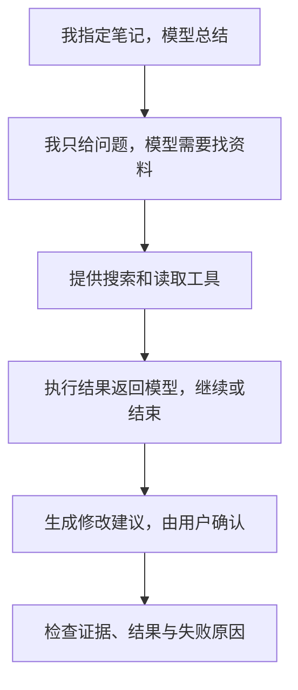

# 00. 前端工程师为什么能做 Agent？从你的疑问说起

## 从 Lauren Tan 的转向说起

这个系列起于你的一个疑问：看到 Lauren Tan（@poteto）从 React 相关工作转向 Grok Bot，你觉得跨度很大。以前写前端的人，怎么突然就能做 AI 了？自己已经会 Web 全栈，也能调用大模型 API，离 Agent 开发究竟还差什么？

这个疑问很自然。我们看到的是两种产品：一边是 React，一边是 AI 助手；容易把产品标签的变化，理解为底层能力也全部换了一套。

先补一个事实：React 官方团队资料把 Lauren 列在 Compiler 方向，她的经历包含 React Compiler，而非仅仅编写业务页面。你看到的 Grok Bot 动态是这次学习的引子；本次未能直接读取她的 X 原页，因此这里不把“产品负责人”写成已确认头衔，也不从她参与应用开发推断她在训练基础模型。[React 团队资料](https://react.dev/community/team)、[你提供的 X 主页](https://x.com/poteto)

我们不能只凭职业标签解释一个人的全部转型经历，但可以把问题拆开：**Agent 应用究竟由哪些东西组成，其中哪些本来就是软件工程？**

## “做 AI”包含几种不同的工作

想象一家餐厅。有人研究怎样培育更好的食材，有人设计厨房设备，有人把食材、厨房和点餐流程组合成顾客真正能吃到的一顿饭。它们互相依赖，但每天要解决的问题不一样。

放到 AI 里，可以先粗分为三类：

| 工作方向 | 主要改变什么 | 常见工作内容 |
|---|---|---|
| 模型研究与训练 | 模型本身的能力 | 训练数据、模型结构、训练与后训练实验 |
| 推理与运行平台 | 模型和任务怎样稳定运行 | 算力利用、服务调度、执行环境、隔离和监控 |
| AI 应用与 Agent 工程 | 用户怎样借助模型完成任务 | 需求、工具接口、上下文、执行流程、权限、效果评估 |

这张表是帮助定位的简图，实际岗位可能跨越几个方向。后面的招聘篇会拿真实岗位练习辨认。

本系列从第三类切入。你使用已经训练好的模型，为它接上笔记、搜索和修改建议，让用户完成一个具体任务。第一步可以继续用 TypeScript 和 HTTP，无需先完成一套模型训练课程。

## 你的 Web 经验，会在什么地方继续使用？

假设原来做的是一个文章后台：用户点击“搜索”，前端调用接口，后端查数据库，页面展示结果。现在用户输入“找出和重试相关的笔记，再解释风险”，其中依然有界面、请求、数据和权限，只是多了模型参与选择动作。

| 你熟悉的工作 | 在 Agent 应用中的对应工作 | 新增的考虑 |
|---|---|---|
| 设计 API 和业务函数 | 把搜索、读取等能力提供为工具 | 模型要能从说明中判断何时使用 |
| 校验请求参数 | 校验模型给出的工具参数 | 模型返回合法 JSON，也可能选错文件 |
| 管理页面状态 | 展示正在检索、等待确认、失败或完成 | 一次任务可能有很多步骤，用户需要知道进展 |
| 管理后端状态 | 保存任务、工具结果、待确认操作 | 中断后哪些动作能重做，哪些不能重复 |
| 测试与日志 | 检查工具、追踪模型调用、评估结果 | 程序正常返回，并不保证内容有依据 |
| 产品交互 | 设计预览、确认、取消和纠错 | 用户要能判断助手做了什么，以及是否接受 |

所以你不是从零开始。你已经会搭建大部分应用外壳；接下来需要学会把一个输出不完全确定的模型，放进可以约束、观察和验证的程序中。

## 最值得适应的变化：你不再预先决定全部步骤

传统业务逻辑也会遇到超时和脏数据，当然不是绝对确定的。但通常由你写出“先查用户，再检查权限，再更新记录”的执行顺序。

在 Agent 的一部分流程里，你会把选择交给模型：先搜哪个词？现有资料够不够？要不要再读一篇？模型选择有灵活性，也可能选错、遗漏或重复。

这像你从“自己逐本取书”，转为“让助手提出取书方案”。你仍要负责目录、取书权限、失败反馈和结果核对。助手会说话，不意味着这些机制会自动出现。

你首先要补的是四件事：工具调用如何往返、每轮提供什么上下文、执行循环如何停止、结果怎样评分。提示词是其中一部分；程序机制与评估同样需要你设计。

## “我现在只会调用 API”其实是一个可用的起点

我们从你已经能做的“把正文发给模型，得到总结”开始。然后每遇到一个真实限制，再增加一种能力：

每条箭头都代表一个需求变化。前面还没解决的问题，不靠提前堆框架名字解决。

实践保持独立：做一个本地 Markdown 笔记助手，先用 CLI（命令行界面）看清输入输出。CLI 就像暂时去掉页面样式，只看请求和业务逻辑；这不是放弃前端经验。理解流程后，页面仍可以通过后端调用同一个执行器。

## 先写下自己的起点

用三句话回答：

1. 我目前用模型 API 实现过什么功能？输入和输出分别是什么？
2. 这个功能中，哪些步骤由我写死？
3. 如果让模型选择下一步，最想交给它哪一个决定？这个决定做错会怎样？

不需要答案很专业。之后每学一个概念，就回来看它是否解决了这里的一个具体问题。

下一章：[从大模型 API 到 Agent：到底多了什么？](./01-从大模型API到Agent.md)
