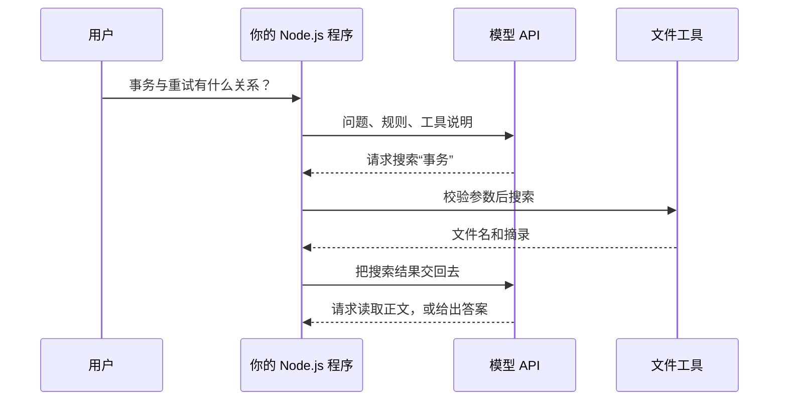
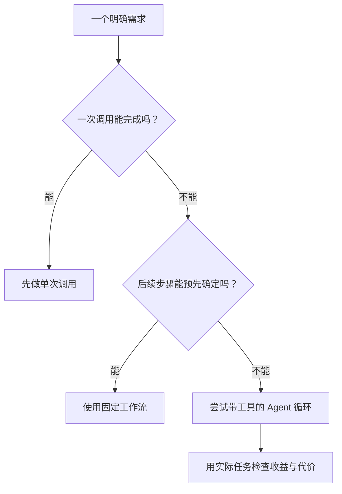

# 01. 从大模型 API 到 Agent：到底多了什么？

## 用同一个笔记需求，比较三种做法

你有两篇 Markdown：一篇解释数据库事务，一篇解释失败后重试。用户想知道：“事务与重试有什么关系？”

先看最熟悉的做法：你自己找到两篇笔记，把正文连同问题发给模型。模型组织答案。这里的“找资料”由你完成，模型只参与最后一步。

如果每次都要人工挑文件，就会想把找资料也写进程序。程序可以固定执行“搜索 → 读取前几条 → 发给模型”。这叫固定工作流：运行时资料会变化，但步骤由代码预先安排。

再往前一步：用户可能换一种说法，第一次搜索没有结果。你希望模型看见失败后换关键词；找到几篇资料后，自行决定继续阅读还是已经足够回答。这时模型开始参与选择后续动作。我们在这个系列中把这种结构称为 Agent。

| 方式 | 谁决定下一步 | 本例 |
|---|---|---|
| 单次模型调用 | 调用方已经准备好资料 | 给两篇正文，生成答案 |
| 固定工作流 | 代码规定步骤 | 搜索一次、读取结果、总结 |
| Agent | 模型在程序允许的范围内选择动作 | 搜不到换词，读完再判断是否继续 |

“Agent”在行业中有宽窄不同的用法。这里借用 Anthropic 对固定工作流与动态决策的区分，帮助你看清代码差异，而不是争论产品该贴哪个标签。[架构说明](https://www.anthropic.com/research/building-effective-agents)

## Agent 不是一次特殊的 API

模型仍然通过 API 接收输入、产生输出。变化发生在 API 周围：程序可能拿到一个工具请求，执行后再次调用模型。

模型和文件之间没有直接箭头。模型说“读取”时只是给出一个请求；你写的程序才拥有实际文件权限。这与后端收到 HTTP 请求后校验再执行业务函数很接近。

## 先认识四样东西，后面逐一实现

**模型**：根据收到的信息生成文字或工具请求。它可能给出错误结论。它也不会因为文件在电脑上，就自动知道文件内容。

**工具**：你提供的可执行能力。例如 `read_note({path: "database.md"})` 最终仍会落到普通文件读取函数。工具说明帮助模型选择；参数校验和权限检查由程序负责。

**上下文**：这次调用中模型能够使用的信息，包括问题、规则、历史和工具结果。把它理解成当前打开的资料页，比把它想成“模型知道的一切”更准确。

**执行循环**：接收模型输出；有工具请求就校验、执行、回传；有最终回答就结束；出错或达到上限则停止。这个循环由程序维持，不是模型在后台自己无限运行。

给模型的工作说明通常叫提示词（Prompt）。工具参数的格式说明通常叫 Schema。我们会在第一次真正使用它们时展开，不要求现在背下来。

## 从 Web 请求到 Agent 任务，增加了哪一段？

你熟悉的 `页面 → API → 业务函数 → 返回` 仍然存在。Agent 应用只是可能在后端插入多次“模型 → 工具 → 模型”的往返。

这带来几个具体变化：

- 等待时间更长：界面需要进度或取消入口，不能总让用户盯着一个没有解释的转圈。
- 失败位置更多：可能是搜索无结果，也可能是模型请求超时；两者的处理不同。
- 检查分成两层：函数执行成功，不等于模型选对函数或答案引用正确。

你仍然设计服务端接口与权限。模型参与决策的部分，才是本系列新增的主线。

## 什么时候暂时不需要 Agent？

如果需求只是“总结这篇文章”，文件已经明确，单次调用通常就是合理起点。增加自主搜索，会引入新的选择和失败机会，却不一定改善任务。

像查书：知道页码时直接翻到那页；不知道资料在哪里时才需要查目录。不能因为查目录更灵活，就让所有阅读都先绕一圈。

这是一张设计判断图，不是“越来越高级”的晋级表。先定义任务，再判断哪种结构足够。

## 三个容易混淆的名称

- **开发 Agent 应用**：你写出本系列的笔记助手。
- **用编程 Agent 开发软件**：你让编程助手协助写代码，方法在附录。
- **应用内部多 Agent**：笔记助手内部存在多个模型角色，涉及路由、共享信息与协调。

本系列通识篇完成第一个。理解一个 Agent 后，才有依据判断产品内部是否需要多个角色；也不需要先掌握多会话开发才能继续学习。

## 小练习：先预测，再看结果

判断下面三个任务各从哪种结构起步，并说明理由：

1. 把指定笔记压缩到三句话。
2. 每晚固定检索新增笔记，生成一份目录。
3. 查明几篇笔记之间的矛盾，找不到依据时尝试其他关键词。

参考判断：分别可以从单次调用、固定工作流、工具循环起步。真正的取舍还要看规模和验收结果；第三项如果范围固定，也可能被一个简单工作流完成。

能向朋友说明“工具调用请求为什么还不是执行动作”，就可以进入下一章。

下一章：[用 TypeScript 总结一篇 Markdown 笔记](./02-用TypeScript总结Markdown笔记.md)
