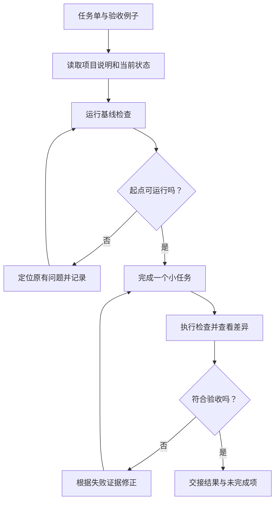

# 02. 先让一个开发 Agent 跑通闭环

## 为什么先只用一个？

如果一条生产线的零件经常不合格，同时开十条，只会更快地积累待检查的零件。

先观察一次完整过程：任务怎样进入、开发 Agent 看了什么、改了什么、依据什么说完成。稳定之后再并行，才知道扩大的是可靠交付，还是返工。



图中的回路表示根据失败证据修正，不是无限尝试；无法说明新假设时，先按本章后面的“卡住时怎样接手”缩小问题。

## 第一步：建立能复现的起点

在配套项目执行：

```bash
npm ci
npm run check
npm run demo
```

`check` 包含类型检查和离线测试。类型检查像检查零件尺寸是否匹配，行为测试像把零件装起来实际转动。TypeScript 类型正确，不代表业务结果正确。

记录当前结果。如果基线已经失败，先解释原因，避免把原有问题误算到新改动上。

## 第二步：给一个小而完整的任务

把下面的任务交给你正在使用的一个开发 Agent。可以在当前聊天之外的练习项目中操作；本系列编写本身不会替你自动派发任务。

```text
先读 README.md、package.json、src/notes.ts、test/notes.test.ts。
为 search() 补充一个行为测试：准备 6 篇都含同一关键词的临时笔记，
验证 matches 只有 5 条，total 为 6。
不要修改模型接口，不要访问真实笔记，不要提交或推送。
完成后运行 npm run check，报告证据。
```

这个练习只增加一项验收证据，不需要改产品行为。配套代码保留了此练习空间；不把它标成已经完成的功能改动。

## 第三步：读懂它给出的证据

检查三件事：

1. **测试是否符合任务。** 是否真的创建了 6 篇笔记？是否同时检查返回条数和总数？
2. **测试是否能发现错误。** 如果错误实现把 `total` 也限制为 5，它会不会失败？可以在独立练习副本中临时改坏这一处验证，随后恢复并重新运行。
3. **变更是否只在范围内。** 不应顺手改提示词、迁移技术栈或整理无关代码。

第二点像检查烟雾报警器：灯亮不等于能报警，要确认出现对应问题时它确实会响。这种故意引入小错误的实验，只在练习副本做。

## 第四步：完成一份交接

用[交接记录](./templates/交接记录.md)记录：

```text
任务：搜索结果截断测试
修改：test/notes.test.ts
验证：npm run check 的实际结果
结论：是否同时证明 matches 截断、total 不截断
未验证：真实模型的选词与回答效果
```

“测试通过”和“整个 Agent 已经可靠”不是同一个结论。这个任务只验证搜索函数的一条行为。

## 卡住时怎样接手？

### 换一个会话，也能接班

长任务像轮班维修。下一位维修工不能只听“差不多修好了”，还需要知道当前机器状态、已验证的部分和下一步。

Anthropic 的长任务工程实践强调增量推进与持久交接。本项目把它缩小为一个练习：结束会话前补好[交接记录](./templates/交接记录.md)；新会话先核对目录、差异、未完成任务，再运行基线，不直接相信上一次的口头结论。[原文](https://www.anthropic.com/research/effective-harnesses-for-long-running-agents)

动手时，可以让新会话仅凭任务单和交接记录说明“下一步为什么做这个”。如果仍需要你复述全部历史，就补上缺失的文件位置或验证证据。这里练的是开发过程接班，笔记助手本身还没有断点恢复功能。

### 反复失败时，先收小问题

开发 Agent 连续修改却无法解释失败时，缩小问题：让它报告当前错误、最小复现和一个待验证假设。不要只是重复“继续修”。

例如，读文件失败要先分清：目录不对、文件不存在，还是工具参数错误。一个明确的失败位置，比重新生成整套实现更有帮助。

## 合上文档讲一遍

为什么“AI 写了测试，并且说测试通过”还不足以验收？用上面 `matches` 与 `total` 的例子回答。

下一章：[给任务独立的工作台](./03-给任务独立的工作台.md)。
