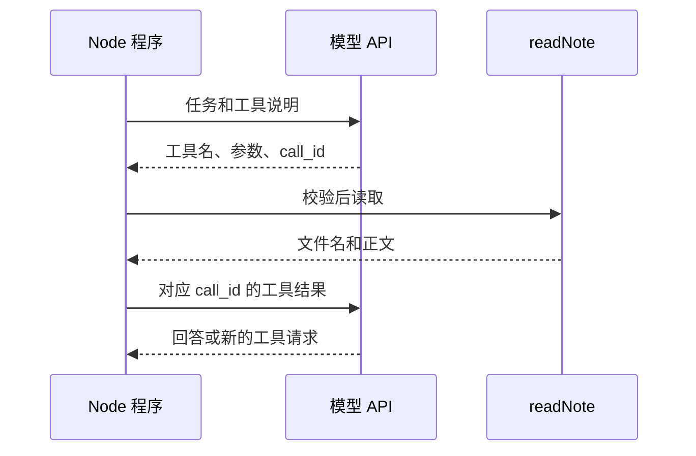

# 03. 工具调用：模型提出请求，程序执行读取

## 上一章程序先取书，这次模型先填取书单

你已经能把指定正文交给模型。现在先只给任务和可用工具，看模型是否请求读取文件。完整顺序是：**描述能力 → 收到工具请求 → 程序校验并执行 → 回传结果 → 模型回答**。

工具说明像取书单，填写单据不会让书自动出现。模型返回工具名和参数，实际权限仍在你的 Node 程序手里。

继续在自己创建的 `note-agent-lab` 中操作，保留第 02 章文件。

## 第一步：写工具说明和执行函数

新建 `read-tool.ts`：

<!-- file: read-tool.ts -->
```ts
import { readNote } from './notes.ts';

export const readTool = {
  type: 'function' as const,
  name: 'read_note',
  description: '读取顶层 Markdown 笔记全文，path 是文件名。',
  strict: true,
  parameters: {
    type: 'object',
    properties: { path: { type: 'string', description: '例如 database.md' } },
    required: ['path'], additionalProperties: false,
  },
};

export async function executeRead(name: string, raw: string) {
  try {
    if (name !== 'read_note') throw new Error('未知工具');
    const args = JSON.parse(raw);
    if (!args || Array.isArray(args) || typeof args !== 'object' ||
      Object.keys(args).length !== 1 || typeof args.path !== 'string') {
      throw new Error('只接受字符串字段 path');
    }
    return { ok: true, data: await readNote(args.path) };
  } catch {
    return { ok: false, error: '参数或文件无效；请检查 path 和笔记文件名' };
  }
}
```

前半段是给模型看的工具菜单，后半段才执行动作。`parameters` 是参数格式，也叫 Schema；`required` 要求提供 `path`，`additionalProperties: false` 拒绝额外字段。

`strict` 请求 API 按格式约束生成，程序仍要检查参数和访问范围。`../README.md` 也是字符串，因此“格式正确”和“允许读取”不是一回事。

先独立验证工具，不调用模型：

```bash
node --input-type=module -e 'import { executeRead } from "./read-tool.ts"; console.log(await executeRead("read_note", JSON.stringify({path:"database.md"})));'
node --input-type=module -e 'import { executeRead } from "./read-tool.ts"; console.log(await executeRead("read_note", JSON.stringify({path:"missing.md"})));'
```

分别应得到 `ok: true` 和 `ok: false`。失败回执告诉模型“没有读到”，不能伪装成“文件内容为空”。

## 第二步：完成一次往返

新建 `one-tool.ts`：

<!-- file: one-tool.ts -->
```ts
import { answerText, createModel } from './model.ts';
import { executeRead, readTool } from './read-tool.ts';

const model = createModel(process.env.OPENAI_API_KEY || '', process.env.OPENAI_MODEL || '');
const first = await model({ input: '请读取 database.md 并说明事务的限制。', tools: [readTool] });
if (first.status !== 'completed') throw new Error('模型响应未完成');
const calls = first.output.filter(item => item.type === 'function_call');
if (calls.length === 0) {
  console.log('本次没有请求工具；请核对回答是否真的有资料依据。');
  console.log(answerText(first));
} else {
  if (calls.length !== 1) throw new Error('本章只演示一次工具请求；连续执行见第 04 章');
  const call = calls[0];
  if (call.name !== 'read_note' || !call.arguments || !call.call_id) throw new Error('调用格式或工具名错误');
  console.log('模型请求：', call.name, call.arguments);
  const result = await executeRead(call.name, call.arguments);
  console.log('程序执行结果：', result);
  const second = await model({
    previousResponseId: first.id,
    tools: [readTool],
    input: [{ type: 'function_call_output', call_id: call.call_id, output: JSON.stringify(result) }],
  });
  if (second.output.some(item => item.type === 'function_call')) throw new Error('模型还想调用工具；本章到此停止，第 04 章加入循环');
  console.log(answerText(second));
}
```

这里有两个编号：`call_id` 对应哪张工具申请单，`previousResponseId` 对应上一轮响应。前者随工具结果回传，后者由适配器转成 API 的 `previous_response_id`。二者不能互换。

`arguments` 是 JSON 字符串，执行器解析后才得到对象；工具结果也需要序列化回传。[官方工具调用说明](https://developers.openai.com/api/docs/guides/function-calling)



正文在第二次请求中才进入模型。模型只看见工具说明时，并没有读到文件。

## 第三步：实际运行

```bash
npm run typecheck
node --env-file=.env one-tool.ts
```

终端会显示工具请求、读取结果和回答。真实模型也可能直接回答，或第二次仍请求工具；代码分别提示缺少读取证据、或停止并指向下一章，不假定每次都按演示路线行动。

没配置模型时，完成第一步的两个本地命令即可；不要把本地读取成功记成模型会使用工具。

复述：工具菜单、工具请求和工具执行分别由谁提供？如果你仍然只说“模型自己读文件”，沿图中的三方再走一遍。

下一章：[Agent 循环与停止条件](./04-Agent循环与停止条件.md)。
