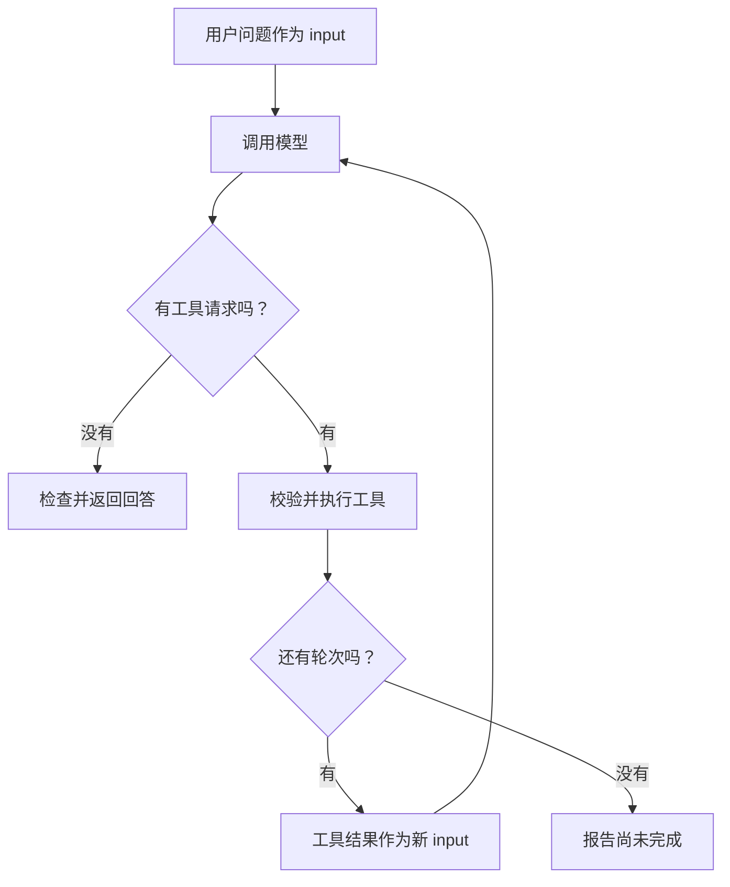

# 04. Agent 循环：读完之后，继续还是结束？

## 一次往返为什么不够？

用户只问“事务与重试有什么关系”，没有指定文件。模型可能先搜索，再读事务笔记，接着读重试笔记，最后组织答案。上一章只处理一次工具往返，这里把同样的机制放进有上限的循环。

继续在 `note-agent-lab` 操作。先新增 `notes/retry.md`：

<!-- file: notes/retry.md -->
```markdown
# 请求重试

网络超时不一定说明操作失败，也可能是操作成功但响应没有送达。
重复读取通常不会改变数据；重复写入可能创建两份订单。
幂等是让同一业务请求重复执行时，不产生额外的业务结果。例如用同一个订单号识别重复请求。
```

## 第一步：增加搜索，复用读取

新建 `search.ts`：

<!-- file: search.ts -->
```ts
import { readdir } from 'node:fs/promises';
import { notesRoot, readNote } from './notes.ts';

export async function searchNotes(query: string) {
  const keyword = query.trim().toLowerCase();
  if (!keyword || keyword.length > 100) throw new Error('关键词长度应为 1～100 个字符');
  const files = (await readdir(notesRoot, { withFileTypes: true }))
    .filter(file => file.isFile() && !file.name.startsWith('.') && file.name.endsWith('.md'))
    .map(file => file.name).sort();
  if (files.length > 50) throw new Error('请使用不超过 50 篇的练习目录');
  const matches: { path: string; snippet: string }[] = [];
  for (const path of files) {
    const { content } = await readNote(path);
    const index = content.toLowerCase().indexOf(keyword);
    if (index >= 0 || path.toLowerCase().includes(keyword)) {
      const start = Math.max(0, index - 30);
      matches.push({ path, snippet: content.slice(start, start + 180) });
    }
  }
  return { matches: matches.slice(0, 5), total: matches.length };
}
```

搜索先返回文件名和短摘录，像目录卡片；`total` 是总命中数，`matches` 最多展示五条。它做字面匹配，没有理解同义表达。

新建 `toolbox.ts`，将搜索加入菜单和分发函数，保留上一章的读取工具：

<!-- file: toolbox.ts -->
```ts
import { searchNotes } from './search.ts';
import { executeRead } from './read-tool.ts';
export { readTool } from './read-tool.ts';

export const searchTool = {
  type: 'function' as const,
  name: 'search_notes',
  description: '用短关键词做字面搜索，返回最多 5 条摘录和总命中数。',
  strict: true,
  parameters: {
    type: 'object',
    properties: { query: { type: 'string', description: '例如 事务' } },
    required: ['query'], additionalProperties: false,
  },
};

export async function execute(name: string, raw: string) {
  if (name === 'read_note') return executeRead(name, raw);
  try {
    if (name !== 'search_notes') throw new Error('未知工具');
    const args = JSON.parse(raw);
    if (!args || Array.isArray(args) || typeof args !== 'object' ||
      Object.keys(args).length !== 1 || typeof args.query !== 'string') {
      throw new Error('只接受字符串字段 query');
    }
    return { ok: true, data: await searchNotes(args.query) };
  } catch {
    return { ok: false, error: '参数无效或搜索失败；请检查 query 和笔记目录' };
  }
}
```

本地检查：

```bash
node --input-type=module -e 'import { searchNotes } from "./search.ts"; console.log(await searchNotes("事务"));'
```

应看到文件名、摘录和总数。现在程序具备搜索与读取两个动作，但还没有把它们连成持续任务。

## 第二步：写执行循环

新建 `agent.ts`：

<!-- file: agent.ts -->
```ts
import { answerText } from './model.ts';
import type { Model, ModelRequest, Tool, ToolResult } from './model.ts';

export async function runAgent(goal: string, model: Model, tools: Tool[],
  execute: (name: string, raw: string) => Promise<unknown>, maxRounds = 6) {
  if (!goal.trim() || goal.length > 4000) throw new Error('任务长度应为 1～4000 个字符');
  if (!Number.isInteger(maxRounds) || maxRounds < 1 || maxRounds > 10) throw new Error('轮数应为 1～10');
  let input: ModelRequest['input'] = goal;
  let previousResponseId: string | undefined;
  for (let round = 1; round <= maxRounds; round++) {
    const response = await model({ input, tools, previousResponseId });
    if (response.status !== 'completed') throw new Error('模型响应未完成');
    const calls = response.output.filter(item => item.type === 'function_call');
    if (!calls.length) return answerText(response);
    if (calls.length > 4) throw new Error('单轮工具请求过多');
    const results: ToolResult[] = [];
    for (const call of calls) {
      if (!call.name || !call.arguments || !call.call_id) throw new Error('调用格式错误');
      const result = await execute(call.name, call.arguments);
      console.log({ round, tool: call.name, arguments: call.arguments, result });
      results.push({ type: 'function_call_output', call_id: call.call_id, output: JSON.stringify(result) });
    }
    previousResponseId = response.id;
    input = results;
  }
  throw new Error(`达到 ${maxRounds} 轮上限，尚未得到最终回答`);
}
```

`runAgent` 接收任务、模型请求函数、工具菜单和执行器，因此既能接真实模型，也能接下面的离线脚本。菜单说明可用能力，执行器通过工具名分发；两者必须一致。

重点追踪 `input`：第一次是用户问题，之后变成工具结果。`previousResponseId` 负责衔接历史，`round` 限制最多调用几次模型。



响应不完整、工具批次超限等协议问题直接停止；正常工具失败以 `ok: false` 返回，让模型有机会调整。达到上限是停止，不是成功。六轮是课堂选择，也不是精确费用预算。

## 第三步：无 Key 观察一次完整循环

新建 `demo.ts`：

<!-- file: demo.ts -->
```ts
import { runAgent } from './agent.ts';
import type { Model } from './model.ts';
import { execute, readTool, searchTool } from './toolbox.ts';

const plan = [
  { name: 'search_notes', args: { query: '事务' } },
  { name: 'read_note', args: { path: 'database.md' } },
  { name: 'read_note', args: { path: 'retry.md' } },
];
let index = 0;
const model: Model = async () => {
  const step = index++;
  const call = plan[step];
  return { id: `response-${step}`, status: 'completed', output: call
    ? [{ type: 'function_call', name: call.name, arguments: JSON.stringify(call.args), call_id: `call-${step}` }]
    : [{ type: 'message', content: [{ type: 'output_text', text: '【脚本演示】工具往返结束；这不是模型生成的答案。' }] }] };
};
console.log(await runAgent('离线演示', model, [searchTool, readTool], execute));
```

```bash
node demo.ts
npm run typecheck
```

你应看到搜索、读事务、读重试三个工具动作，再看到明确标注的脚本结束语。这里的文件工具确实执行，模型选择与回答均由脚本预设；它不能证明真实模型能力。

将 `demo.ts` 最后一行调用增加第五个参数 `2`，即 `runAgent(..., execute, 2)`，会在两轮后报未完成。观察后恢复。上限由程序控制，提示词里的“最多两轮”不能替代它。

## 第四步：换成真实模型

新建 `ask.ts`：

<!-- file: ask.ts -->
```ts
import { createModel } from './model.ts';
import { runAgent } from './agent.ts';
import { execute, readTool, searchTool } from './toolbox.ts';

const goal = process.argv[2] || '事务与重试有什么关系？请读取笔记并引用。';
const model = createModel(process.env.OPENAI_API_KEY || '', process.env.OPENAI_MODEL || '');
console.log(await runAgent(goal, model, [searchTool, readTool], execute));
```

```bash
node --env-file=.env ask.ts "事务与重试有什么关系？请引用笔记。"
```

真实模型可以改变关键词和阅读顺序。核对证据和结果，而不是要求它复刻离线脚本。终端为教学打印参数及虚构正文；接真实私人资料时，需要另外设计日志脱敏。

复述：是谁维持循环？哪一步让模型看到了工具反馈？为什么最后返回了文字，也仍需要检查答案对不对？

下一章：[上下文与 RAG](./05-上下文与RAG.md)。
