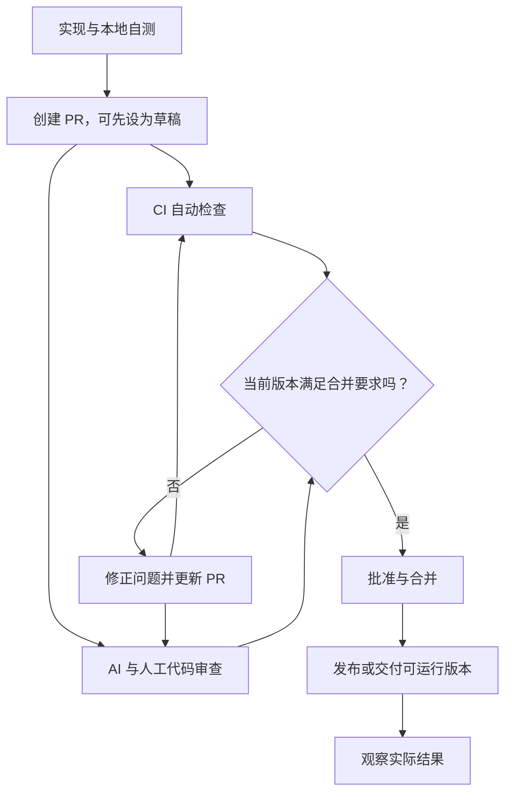

# 05. 从测试和审查走到交付

## 谁说“能交付”才算数？

把软件交付看成出厂检查。尺寸检查、通电试验、人工观察分别能发现不同问题；任何一项都不代表整个产品绝对无故障。

本项目的检查也是这样分工：

| 检查 | 能提供什么证据 | 不能代替什么 |
|---|---|---|
| TypeScript | 已声明的类型是否匹配 | 文件内容和模型输出在运行时是否正确 |
| 离线测试 | 给定场景下程序行为是否符合预期 | 真实模型是否善于选工具、找证据 |
| AI Review | 对代码逻辑与遗漏的审查建议 | 实际运行、业务验收和权限边界 |
| 人工验收 | 结果是否解决需求，取舍是否合理 | 每次重复执行的自动检查 |

让同一个模型多说一次“没问题”，并没有增加一条确定的执行证据。

## 本地先跑哪几项？

```bash
npm run typecheck
npm test
npm run demo
```

前两项也可以合为 `npm run check`。这个小型 CLI 不需要打包，所以没有虚构的 `build` 命令；第一版也没有配置 Lint，不把不存在的检查写成已通过。

测试使用临时目录，不碰样例以外的真实笔记。模拟 HTTP 请求也不会访问云端或消耗模型费用。

## CI 是把检查搬到另一张干净工作台

CI，即持续集成，会在代码变更时自动准备环境并运行约定检查。它像固定执行的检查站，让“我电脑上能跑”变成别人也能复现的证据。

在复制出来的独立练习仓库中执行：

```bash
mkdir -p .github/workflows
cp ci/quality.yml .github/workflows/quality.yml
```

模板的实际步骤是：

```text
检出代码 → 安装 Node 24 → npm ci → npm run check → npm run demo
```

`npm ci` 按 `package-lock.json` 安装依赖，因此锁文件要进入独立项目的 Git 历史。CI 不需要模型 Key；真实模型评估留给单独的受控运行。[GitHub Node.js CI 指南](https://docs.github.com/en/actions/tutorials/build-and-test-code/nodejs)

模板放入仓库并提交、推送到你自己的 GitHub 项目后才会触发。复制文件本身不等于 CI 已运行，更不等于检查已被设置为合并必需条件。

## PR、审查、合并、发布分别是什么？



CI 和审查是两路证据，判断点要一起看；修正代码后，旧版本的检查结果不能自动代表新版本。

PR 是把一组修改交给别人检查的容器，通常先有 PR，再进行围绕它的正式审查。合并只是代码进入目标分支，不自动等于线上发布。

本项目第一轮是本地 CLI，“交付”可以是一个已验证的提交及启动说明。没有服务器部署，也不需要为了完整而添加 CD 流水线。

## 按变更影响决定检查深度

改一处帮助文字，与修改 `Notes.apply()` 的写入逻辑，影响明显不同。后者至少要检查：未确认不能写、原文变化拒绝写、重复应用拒绝写。

第一轮由人决定合并。未来考虑自动合并时，需要把适用范围、必需检查和禁止条件落实到仓库规则；一句“低风险自动合并”还不是实现。

回滚也分两层：撤回代码提交，不会自动恢复已被程序改写的笔记。本例建议保留修改前后的内容，并在确认写回后检查文件差异。需要恢复内容时，根据当前文件再做一次明确修改，不把代码回滚当作数据恢复。

## 给审查者一条具体规则

只说“请检查代码质量”，像让质检员“认真一点”，没有指出产品最容易出错的地方。OpenAI 的代码审查实践建议提供少量、与当前代码相关的项目规则，并用该触发和不该触发的例子检查规则是否有用。[代码审查规则原文](https://developers.openai.com/blog/custom-code-review-rules-for-codex)

在独立练习仓库中，可以把下面这条写进项目的 `AGENTS.md`：

> 修改笔记前，必须确认用户明确同意，且当前正文仍等于建议里的 before。审查写入相关变更时，检查这两个条件及对应测试。

只读审查时比较三个假设变更：删除确认检查、保留检查但调整错误文案、仅修改搜索帮助。第一项应该指出缺陷，后两项不应仅因触及项目就套用同一条警告。最后仍运行测试，审查意见本身不执行写入保护。

## 动手与复述

选择 `test/notes.test.ts` 中“原文被修改，应用旧建议必须失败”的测试，指出它如何准备场景、执行动作和检查结果。

再解释：为什么它比一段“AI 已确认不会覆盖用户内容”的文字更有说服力？它又有哪些没覆盖的条件？例如，多进程同时替换文件不属于这个单用户示例的保证范围。

下一章开始拆开笔记助手：[先让模型读懂一篇笔记](./06-先让模型读懂一篇笔记.md)。
