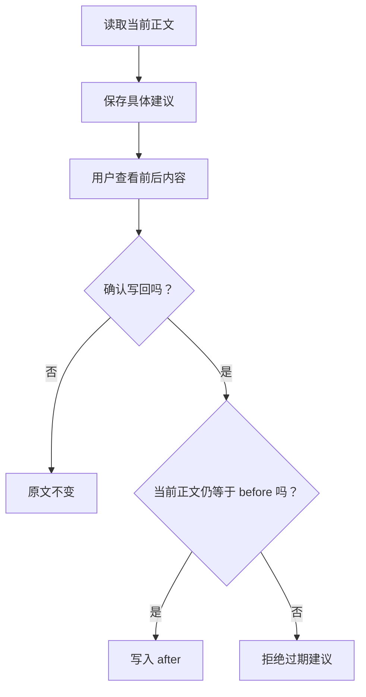

# 06. 修改文件：先给建议，再由用户确认

## 能回答以后，为什么不能直接开放写文件？

答错一句话和覆盖原文，后果不同。像编辑校样，提出改字意见的人不能自己盖一个“已批准”就触发印刷。

我们继续修改自己的练习项目，增加一个工具：`propose_replace`。模型只申请替换，程序保存前后内容。真正写回由用户另跑一个命令，模型拿不到这个动作。

## 第一步：让建议成为一个具体对象

在 `note-agent-lab` 新建 `proposals.ts`：

<!-- file: proposals.ts -->
```ts
import { mkdir, writeFile } from 'node:fs/promises';
import { randomUUID } from 'node:crypto';
import { join } from 'node:path';
import { notesRoot, readNote } from './notes.ts';
import { execute } from './toolbox.ts';

export const proposeTool = {
  type: 'function' as const, name: 'propose_replace', strict: true,
  description: '先读取笔记，再提出一处替换建议。只保存建议，不修改原文。',
  parameters: {
    type: 'object', properties: {
      path: { type: 'string' }, old_text: { type: 'string' }, new_text: { type: 'string' },
    }, required: ['path', 'old_text', 'new_text'], additionalProperties: false,
  },
};
export function createProposalExecutor() {
  const readVersions = new Map<string, string>();
  return async (name: string, raw: string) => {
    if (name !== 'propose_replace') {
      const result = await execute(name, raw);
      if (name === 'read_note' && result.ok && result.data && 'content' in result.data) {
        readVersions.set(result.data.path, result.data.content);
      }
      return result;
    }
    try {
      const args = JSON.parse(raw);
      if (!args || typeof args !== 'object' || Array.isArray(args) || Object.keys(args).length !== 3 ||
          ['path', 'old_text', 'new_text'].some(key => typeof args[key] !== 'string')) throw new Error('参数无效');
      const { content: before } = await readNote(args.path);
      if (readVersions.get(args.path) !== before) throw new Error('请先重新读取当前笔记');
      if (!args.old_text || before.split(args.old_text).length !== 2) throw new Error('旧文本必须恰好出现一次');
      const after = before.replace(args.old_text, () => args.new_text);
      if (after === before || Buffer.byteLength(after) > 16 * 1024) throw new Error('修改为空或内容过大');
      const proposal = { id: randomUUID(), root: notesRoot, path: args.path, before, after };
      await mkdir('.proposals', { recursive: true });
      await writeFile(join('.proposals', `${proposal.id}.json`), JSON.stringify(proposal, null, 2), { flag: 'wx' });
      return { ok: true, data: proposal };
    } catch (error) {
      return { ok: false, error: error instanceof Error && !('code' in error) ? error.message : '文件操作失败' };
    }
  };
}
```

`readVersions` 保存本次执行器实际读到的正文。提建议时重新读取并比较，避免模型依据旧内容定位。`old_text` 必须只出现一次，像修改校样时必须指出唯一的一段，而不能说“把这里的‘它’都改掉”。

建议保存 `id/root/path/before/after`：哪个目录、哪篇笔记、原文是什么、准备改成什么。此时只写 `.proposals/`，笔记还没变。

## 第二步：把建议工具接入已有循环

新建 `suggest.ts`：

<!-- file: suggest.ts -->
```ts
import { createModel } from './model.ts';
import { runAgent } from './agent.ts';
import { readTool, searchTool } from './toolbox.ts';
import { createProposalExecutor, proposeTool } from './proposals.ts';

const execute = createProposalExecutor();
if (process.argv.includes('--demo')) {
  console.log('本地脚本：模拟工具请求，不调用模型。');
  await execute('read_note', JSON.stringify({ path: 'database.md' }));
  console.log(await execute('propose_replace', JSON.stringify({
    path: 'database.md', old_text: '事务让多步修改一起成功或失败。',
    new_text: '事务把多步修改视为一个整体：要么一起成功，要么一起撤回。',
  })));
} else {
  const model = createModel(process.env.OPENAI_API_KEY || '', process.env.OPENAI_MODEL || '');
  console.log(await runAgent('读取 database.md，把解释事务的第一句话改得更易懂。只生成建议。',
    model, [searchTool, readTool, proposeTool], execute));
}
```

先用虚构笔记副本练习。在项目目录执行：

```bash
note_dir="$(mktemp -d "${TMPDIR:-/tmp}/note-proposal.XXXXXX")"
cp notes/*.md "$note_dir/"
NOTES_DIR="$note_dir" node suggest.ts --demo
```

应得到 `ok: true`、建议 ID 和前后内容。脚本模拟模型提出请求，建议文件的生成是真的。去看副本中的 `database.md`，原文应仍然存在。

配置好模型后，使用相同入口去掉 `--demo`：

```bash
NOTES_DIR="$note_dir" node --env-file=.env suggest.ts
```

这是实际模型请求。模型可能建议失败，以工具结果为准，不能只听最后一句“我已经完成”。

## 第三步：由你确认保存

新建 `apply.ts`：

<!-- file: apply.ts -->
```ts
import { readFile, writeFile, rename, rm } from 'node:fs/promises';
import { join } from 'node:path';
import { notesRoot, readNote, notePath } from './notes.ts';

const [id, flag] = process.argv.slice(2);
if (!/^[a-f0-9-]{36}$/.test(id || '')) throw new Error('请提供有效的建议 ID');
if (flag && flag !== '--yes') throw new Error('只接受 --yes 确认标志');
const proposal = JSON.parse(await readFile(join('.proposals', `${id}.json`), 'utf8'));
if (!proposal || proposal.id !== id || proposal.root !== notesRoot ||
    ['path', 'before', 'after'].some(key => typeof proposal[key] !== 'string') ||
    Buffer.byteLength(proposal.after) > 16 * 1024) throw new Error('建议无效或不属于当前笔记目录');
const current = await readNote(proposal.path);
if (flag !== '--yes') {
  console.log('旧文：', proposal.before, '\n新文：', proposal.after);
  console.log('尚未写入；确认后保持相同的 NOTES_DIR，在原命令末尾添加 --yes。');
} else {
  if (current.content !== proposal.before) throw new Error('原文已变化，请重新生成建议');
  const temp = join(notesRoot, `.${id}.tmp`);
  await writeFile(temp, proposal.after, { flag: 'wx' });
  try {
    await rename(temp, notePath(proposal.path));
    console.log('已写入，请核对文件。');
  } finally { await rm(temp, { force: true }); }
}
```

把“建议ID”替换为刚才返回的编号，保持同一个 `note_dir`：

```bash
NOTES_DIR="$note_dir" node apply.ts 建议ID
NOTES_DIR="$note_dir" node apply.ts 建议ID --yes
```

第一条只展示完整旧文和新文，第二条才写回。`--yes` 是你传入的命令参数；模型回答或笔记里写“已批准”不具有同样效果。程序不强制你先运行预览，预览是推荐交互步骤。



再次执行同一建议，当前正文已经不等于 `before`，应拒绝。它防止这个课堂场景重复覆盖，不等于所有外部工具都天然具备幂等性。

## 第四步：主动制造一次过期建议

重新执行“准备副本”和 `suggest.ts --demo`。这次先手动给副本的 `database.md` 加一行，再确认旧建议。预期拒绝，并保留新增内容。

运行 `npm run typecheck`。然后解释：先读、唯一定位、用户确认、版本一致，分别解决什么问题？

写入使用临时文件再替换，减少只写了一半的风险，但没有多进程锁。这是单用户练习，不保证检查与替换之间不会被其他进程修改。以后接 Web 时，还要在服务端核对用户与笔记权限；前端确认按钮不能替代鉴权。

下一章：[调试与效果评估](./07-Agent调试与效果评估.md)。
