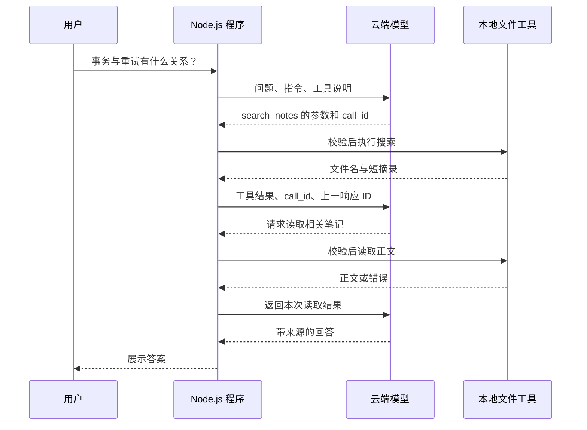
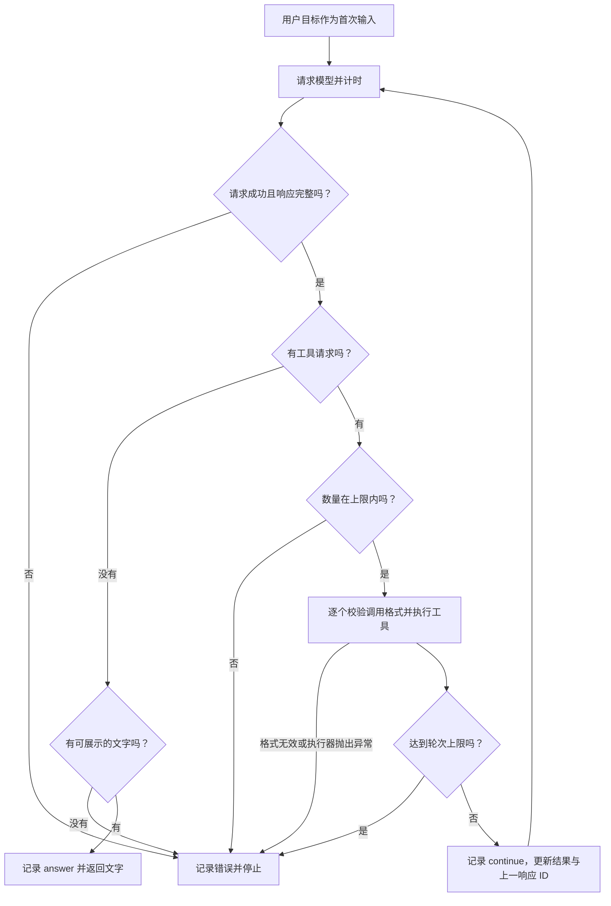

# 07. 让模型申请工具并继续执行

## 从递书变成接收取书单

上一章由你指定文件。现在用户只说：“事务与重试有什么关系？”程序并不知道要读哪些文件。

我们给模型一张工具菜单：能搜索，能读文件；模型根据需求填写取书单，程序检查单据、执行动作，再返回结果。

这里的 tool calling，也叫工具调用，指的是这套请求与反馈机制。工具本身仍然是普通函数。



从上往下看时间，从左往右看谁在执行。模型与文件工具之间没有直接箭头：每次动作都经过 Node.js 校验和执行。这是一条可能的成功路径，真实模型可以用不同的有效顺序完成任务。

## 第一步：让模型知道有哪些工具

打开 `src/tools.ts` 的 `definitions()`。工具说明包含名称、用途和参数结构。以下是简化后的单个工具示意，不是另一份待粘贴配置：

```ts
{
  type: 'function',
  name: 'read_note',
  description: '读取指定笔记全文',
  parameters: {
    type: 'object',
    properties: { path: { type: 'string' } },
    required: ['path'],
    additionalProperties: false,
  },
  strict: true,
}
```

Schema 是申请表的格式说明：`path` 要填字符串，不能随便加字段。它限制格式，不判断内容是否允许。例如 `../secret.md` 仍是字符串，目录边界必须由文件工具检查。

本项目的工具说明启用严格参数格式，同时保留服务端运行时校验。[官方函数调用指南](https://developers.openai.com/api/docs/guides/function-calling)

工具说明也要告诉模型“什么时候用、结果有哪些限制、出错怎么办”。`search_notes` 现在明确说明是字面匹配、最多返回 5 条，并提示结果未完整展示时缩小关键词；`propose_replace` 则强调只生成建议。

Anthropic 的工具设计文章强调用途清楚、返回信息有用、减少无关输出。落实到本例，就是让取书单和回执足够明确，而不是新增一堆名称相近的工具。[工具设计原文](https://www.anthropic.com/research/writing-tools-for-agents)

## 第二步：收到请求后真正执行

模型可能返回这样的输出项：

```json
{
  "type": "function_call",
  "name": "read_note",
  "arguments": "{\"path\":\"database.md\"}",
  "call_id": "call-example"
}
```

注意 `arguments` 是装着 JSON 的字符串，还需要 `JSON.parse()`。类型断言只影响 TypeScript 的理解，不能代替运行时检查。

`createExecutor()` 先检查当前模式是否有这个工具，再解析并检查参数，最后调用 `notes.read()`。工具不存在、参数错误、文件读不到时，都返回 `{ ok: false, error: ... }`。

错误也要返回模型。取书员说“这本书不在柜子里”，值班员才有机会换一本；什么都不回，对方就不知道失败在哪一步。

本例中，文件不存在会返回“先用 search_notes 查找准确文件名”，不把包含本机绝对路径的系统报错直接发给模型。参数错误提示应填写的字段。工具的 `{ ok: false }` 可以进入下一轮；模型请求失败、响应不完整或额度上限则停止，不能把所有错误都当作自动重试的理由。

## 第三步：把结果送回对应的请求

`src/agent.ts` 会构造下面的结果项：

```ts
{
  type: 'function_call_output',
  call_id: call.call_id,
  output: JSON.stringify(result),
}
```

`call_id` 像取书单编号，说明这份结果回答哪次请求；`previous_response_id` 像上一轮会话的卷宗号，帮助 API 衔接之前的上下文。两个 ID 负责不同层级，不能交换。

本例选择服务端保存响应并通过上一响应 ID 衔接。每次请求仍传入当前指令和工具说明；第一次 CLI 请求没有上一响应 ID，后续轮次才有。

## 第四步：没有工具请求时回答，有请求时继续

完整实现见 `runAgent()`。这张图同时画出正常路径和停止条件：



回到模型的箭头携带工具结果，包括可处理的 `{ ok: false }`。执行器意外抛出异常时则走停止分支。返回文字只表示本次执行结束，不证明答案已经通过效果评估。

一轮指一次模型请求及其后续工具处理，不是一个文件。实现会处理响应中的所有函数请求，而不是只取第一条；第一版请求禁用了并行工具调用，并额外限制异常批次最多 4 个。

轮次上限像给查资料安排一个停止点，避免一直绕路。它不是精确的费用上限：不同轮次的输入长度不同，仍需查看 token 用量和实际账单。

每轮在 `finally` 中留下轨迹，包括发生异常的那一轮。`outcome` 区分继续、回答和错误，`errorCode` 说明请求失败、空回答或轮次耗尽等停止原因。日志只记分类，不复制模型正文或密钥。

## 先观察离线链路，再调用真实模型

```bash
npm run demo
```

打开 `src/demo.ts`，找到写好的三个工具请求。这是模拟模型，目的是让你稳定地看到调用与反馈。文件工具是真的，模型选择不是。

再看失败怎样结束：

```bash
npm run demo:failure
```

第一段模拟模型请求失败，应看到 `model_request_failed`；第二段故意重复请求不存在的文件，先返回工具错误，到第 2 轮以 `round_limit` 停止。试着沿上面的图指出两段各走哪条路径，再去 `src/failure-demo.ts` 核对。这里把上限设为 2 轮，方便观察，不改变正常任务的默认 6 轮。

配置好 Key 后，再执行真实任务：

```bash
npm run start -- ask "事务与重试有什么关系？请分别引用相关笔记。"
```

观察终端显示了哪些工具，再检查答案是否有 `database.md` 和 `retry.md` 的依据。真实模型可能换关键词或改变阅读顺序，这不自动代表失败；最终结果与执行约束才是验收对象。

## 动手与复述

打开 `test/agent.test.ts`，阅读“执行工具后携带调用 ID 和上一响应 ID”的测试。分别指出第一次请求的输入，以及第二次请求的输入。

用“取书单、取书员、回执”讲一遍，再不用类比讲一遍。必须说清：**模型产生请求，程序执行工具，模型接收结果后才继续。**

下一章：[给模型合适的资料与状态](./08-给模型合适的资料与状态.md)。
