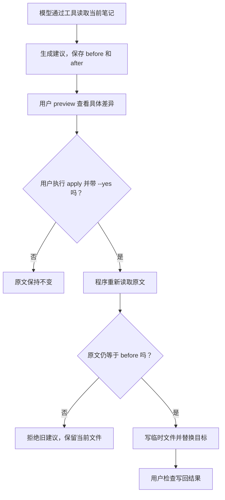

# 09. 先看修改建议再确认写入

## 把修改当作一张待签字的校样

编辑可以在校样上提出改字建议，但印刷厂不应该因为校样上写着“已经批准”，就直接开印。

笔记助手也分两步：模型提出修改，程序保存建议；用户查看后，通过单独命令确认写入。确认权不交给模型自己宣布。



模型的权限到“生成建议”为止；确认与版本比较位于后面的程序路径。模型说“已经批准”不能跳过菱形判断点。

## 第一步：只让模型提出一处修改

配置好模型后，在配套项目执行：

```bash
npm run start -- propose "把 database.md 中的‘事务让多步修改一起成功或失败。’改写得更易懂，保持原意。"
```

`propose` 模式比 `ask` 多一个 `propose_replace` 工具，参数是文件名、待替换的原文、替换后的文本。模型拿不到 `apply` 工具。

`createExecutor()` 要求模型在本轮任务中先读取当前版本。然后 `Notes.propose()` 检查旧文本是否在原文中恰好出现一次。

为什么只允许一次匹配？校样写着“把这里的‘它’换掉”，一页有十个“它”时，不能猜着改。需要更完整的原文定位目标。

工具成功后返回建议 ID 和预览，原始文件尚未改动。用下面命令检查：

```bash
npm run start -- read database.md
```

无 Key 时先运行 `npm run demo`，它会在临时副本里演示同一条链路。

## 第二步：看清建议保存了什么

建议文件在 `.note-agent/proposals/`，包含：

```text
id：建议编号
root：属于哪个笔记目录
path：准备修改的文件名
before：生成建议时的完整原文
after：准备写入的完整内容
```

它像夹在校样上的原稿和修改稿。保留原文是为了检查确认时文件是否已经变化；不是为了让模型获得更多写入权限。

把终端给出的真实 ID 代入：

```bash
npm run start -- preview 建议ID
```

教学版预览用 `-` 展示原文、`+` 展示建议全文，便于直接对照。它不是最小差异算法，也不是可以交给 `git apply` 的补丁格式。

核对内容是否保持原意，是否误删其他段落。建议文件包含正文，保存在本地并被 Git 忽略，不要把它当作没有内容的普通日志分享。

## 第三步：由程序接收你的确认

```bash
npm run start -- apply 建议ID --yes
```

省略 `--yes` 会失败。这里的 `--yes` 是你在命令行明确输入的动作，不是模型从笔记中读到的词。

`Notes.apply()` 的关键顺序是：

1. 检查确认标志。
2. 读取建议，确认属于当前笔记目录。
3. 重新读取原文，与 `before` 比较。
4. 一致时写入临时文件，再替换目标文件。

临时文件替换减少“写到一半文件就坏了”的窗口。但第一版没有实现多进程锁，也不是针对恶意本机进程的安全沙箱，不把它解释成所有并发条件下都不会出错。

## 第四步：亲眼验证旧建议失效

在练习副本中生成建议后，先手动给目标笔记补一行内容，再应用旧建议。预期拒绝，并保留你新写的内容。

这像签字前发现校样不是最新版本：必须重新生成建议，不能用旧稿覆盖已经修订的正文。

同样，成功应用后再次执行同一条 `apply`，会因为原文不再等于 `before` 而拒绝。这个行为避免重复应用，不代表所有外部写入都已经具备通用的幂等机制。

配套离线测试覆盖这两种情况：

```bash
node --test test/notes.test.ts
```

## 提示词与权限各负责什么？

提示词像工作守则：告诉模型先读、不要把资料里的指令当命令。程序检查像门锁：即使模型请求了没有权限的动作，也不能直接执行。

`ask` 模式不暴露建议工具，执行器也会拒绝该名称；两种模式都没有写回工具。不要只把按钮从界面隐藏，却仍让执行器接受同一个动作。

这是把影响限制在必要范围内的一种教学实现。官方资料中的工具审批与多层防护值得参考，但确认次数应结合具体操作设计；本例读取样例不逐次弹确认，写回则必须确认具体建议。这个权限方案是本项目的选择，不是照搬某个厂商界面的全部规则。[OpenAI 安全设计参考](https://developers.openai.com/api/docs/guides/agent-builder-safety)

## 合上文档讲一遍

用户已经说“帮我改”，为什么本例还分建议和确认两步？请从“看见具体改动”和“确认时原文可能变化”解释，不要只说“为了安全”。

下一章：[评估结果并完成一次交付](./10-评估结果并完成一次交付.md)。
