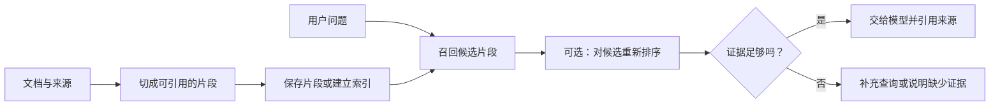

# 09. 检索进阶：用户换一种说法，为什么就找不到资料？

## 先看到旧方法的缺口

第 05 章的字面搜索能找到“重试”，但用户可能问“失败后再试一次”。两句话含义接近，字符却不完全相同。

这像拿着口语描述去查一本按标题编排的目录。目录可能确实有你要的书，但检索方式没有把两种表达联系起来。此时先修“找资料”，直接更换回答模型不一定有用。

本章继续在自己的 `note-agent-lab` 中练习。新建 `retrieval.ts`，放入五篇虚构短文和最小检索函数：

<details>
<summary>展开 retrieval.ts 完整内容</summary>

<!-- file: retrieval.ts -->
```ts
export type Document = { id: string; title: string; content: string };
export type Chunk = Document & { chunkId: string };
export type Hit = Chunk & { score: number };
export const documents: Document[] = [
  {"id":"transaction","title":"事务","content":"事务让多步修改一起成功或失败。事务不能自动消除重复请求。"},
  {"id":"retry","title":"重试","content":"重试用于处理暂时失败。超时不一定代表服务端没有完成操作，重试可能造成重复写入。"},
  {"id":"idempotency","title":"幂等","content":"幂等设计让同一业务请求重复执行时保持一致结果。可以用幂等键识别重复请求，但必须同时检查请求内容是否一致。"},
  {"id":"cache","title":"缓存","content":"缓存复用已经得到的结果，减少重复计算。过期策略不当会返回旧内容。"},
  {"id":"permission","title":"权限","content":"权限校验应在服务端执行。隐藏前端按钮不能阻止未经授权的接口调用。"}
];

export function splitDocument(doc: Document, size = 80, overlap = 15): Chunk[] {
  if (!Number.isInteger(size) || !Number.isInteger(overlap) || size < 1 || overlap < 0 || overlap >= size) {
    throw new Error('切片长度必须为正整数，重叠必须小于长度');
  }
  const chars = Array.from(doc.content);
  const result: Chunk[] = [];
  for (let start = 0; start < chars.length; start += size - overlap) {
    result.push({ ...doc, content: chars.slice(start, start + size).join(''), chunkId: `${doc.id}:${start}` });
    if (start + size >= chars.length) break;
  }
  return result;
}

export const chunks = documents.flatMap(doc => splitDocument(doc));
export type Strategy = 'literal' | 'expanded';
export function queryTerms(query: string, strategy: Strategy): string[] {
  const term = query.trim().toLowerCase();
  if (!term || term.length > 100) throw new Error('问题长度应为 1～100 个字符');
  if (strategy === 'literal') return [term];
  // 只根据开发组增加的两条规则，不代表通用语义理解。
  if (term.includes('再试')) return ['重试'];
  if (term.includes('提交两遍')) return ['幂等'];
  return [term];
}

export function search(query: string, strategy: Strategy = 'literal', k = 3): Hit[] {
  if (!Number.isInteger(k) || k < 1) throw new Error('k 必须是正整数');
  const terms = queryTerms(query, strategy);
  return chunks.map(chunk => ({ ...chunk, score: terms.reduce((sum, term) =>
    sum + (chunk.content.toLowerCase().includes(term) ? 1 : 0) + (chunk.title.toLowerCase().includes(term) ? 2 : 0), 0) }))
    .filter(hit => hit.score > 0).sort((a, b) => b.score - a.score || a.chunkId.localeCompare(b.chunkId)).slice(0, k);
}

export function cosine(a: number[], b: number[]) {
  if (!a.length || a.length !== b.length || [...a, ...b].some(x => !Number.isFinite(x))) throw new Error('向量维度或数值无效');
  const norm = Math.hypot(...a) * Math.hypot(...b);
  return norm === 0 ? 0 : a.reduce((sum, value, i) => sum + value * b[i], 0) / norm;
}

// 重排接口：评分函数可以替换成模型；本实验只注入确定性的教学评分。
export function rerank(candidates: Hit[], score: (hit: Hit) => number): Hit[] {
  return candidates.map(hit => ({ ...hit, score: score(hit) })).sort((a, b) => b.score - a.score);
}
```

</details>

再新建 `retrieval-demo.ts`，把输入、检索结果和演示连起来：
<!-- file: retrieval-demo.ts -->
```ts
import { search, splitDocument, documents, cosine, rerank } from './retrieval.ts';
const query = process.argv[2] || '失败后再试一次';
console.log('原始字面搜索：', search(query, 'literal').map(x => x.id));
const expanded = search(query, 'expanded');
console.log('开发组规则扩词：', expanded.map(x => x.id));
console.log('缩小切片后的第一篇：', splitDocument(documents[0], 20, 5));
console.log('手算向量相似度（不是模型 embedding）：', cosine([1, 0], [1, 1]));
console.log('教学重排（标题含重试优先）：', rerank(expanded, hit => hit.title.includes('重试') ? 2 : 1).map(x => x.id));
```


```bash
node retrieval-demo.ts
```

默认问题是“失败后再试一次”。输出会比较 `literal` 与 `expanded`：前者只查原词，后者用两条人工规则把部分口语转成“重试”或“幂等”。你应看到前者空结果、后者命中 `retry`。这是规则改进，不是向量检索或模型语义理解。

## 把检索拆成能检查的几个环节



这张图是完整 RAG 的位置图。本章代码实际练到候选检索与排序，不调用生成模型；“有候选”与“能据此回答”之间仍有证据判断。

### 切片：把长书拆成带页码的段落

模型输入有容量，整本书也可能混入大量无关内容。因此先切片，每片保留文档 ID、标题和位置。`splitDocument()` 默认按 80 个 Unicode 码点切分，相邻片段重叠 15 个，`chunkId` 记录起点。

重叠像复印时保留一点上下文，减少句子被切断的影响，但会增加重复。这个固定长度算法用于观察机制；真实 Markdown 通常还应考虑标题、段落与代码块。不要把 80/15 当成通用最佳参数。

把 `retrieval-demo.ts` 中的演示切片长度从 20 改到 10，观察“资料变碎”和“来源仍可追踪”同时发生。基础项目的原文不会被修改。

### Embedding：让不同说法能在同一个空间比较

Embedding 把一段文字转换成一串数字。可以把它类比成给书放到一张主题地图上：问题与相关段落可能更靠近。不过真实向量维度没有固定的人类标签，距离也不是“事实正确概率”。

`cosine([1, 0], [1, 1])` 用手写二维向量演示夹角相似度，结果约为 0.707。它只解释比较方法，这两组数字不是文本模型生成的向量。

选做真实向量请求：在已有 `.env` 中另外填写 `OPENAI_EMBEDDING_MODEL`，选择账号可用的 Embedding 模型。新建 `vector-demo.ts`：

<details>
<summary>展开 vector-demo.ts 完整内容</summary>

<!-- file: vector-demo.ts -->
```ts
import { chunks, cosine } from './retrieval.ts';

if (!process.argv.includes('--live')) throw new Error('此实验会调用付费 Embeddings API；确认后显式传入 --live');
const apiKey = process.env.OPENAI_API_KEY;
const model = process.env.OPENAI_EMBEDDING_MODEL;
if (!apiKey || !model) throw new Error('请配置 OPENAI_API_KEY 与 OPENAI_EMBEDDING_MODEL');
const query = process.argv.slice(2).find(x => x !== '--live') || '失败后再试一次';
if (!query.trim() || query.length > 100) throw new Error('问题长度应为 1～100 个字符');
const response = await fetch('https://api.openai.com/v1/embeddings', {
  method: 'POST', signal: AbortSignal.timeout(60_000),
  headers: { Authorization: `Bearer ${apiKey}`, 'Content-Type': 'application/json' },
  body: JSON.stringify({ model, input: [...chunks.map(x => `${x.title}\n${x.content}`), query], encoding_format: 'float' }),
});
if (!response.ok) throw new Error(`Embeddings HTTP ${response.status}`);
const data = await response.json();
if (!data || !Array.isArray(data.data) || data.data.length !== chunks.length + 1) throw new Error('向量数量不匹配');
const vectors: number[][] = Array.from({ length: chunks.length + 1 });
for (const item of data.data) {
  if (!Number.isInteger(item.index) || item.index < 0 || item.index >= vectors.length || vectors[item.index] ||
      !Array.isArray(item.embedding) || !item.embedding.length || item.embedding.some((x: unknown) => typeof x !== 'number' || !Number.isFinite(x))) {
    throw new Error('向量响应无效');
  }
  vectors[item.index] = item.embedding;
}
const queryVector = vectors[chunks.length];
console.log(chunks.map((chunk, i) => ({ chunkId: chunk.chunkId, score: cosine(queryVector, vectors[i]) }))
  .sort((a, b) => b.score - a.score).slice(0, 3));
console.log('本次真实 API 用量：', data.usage ?? '未返回');
```

</details>

配置后运行：

```bash
node --env-file=.env vector-demo.ts --live "失败后再试一次"
```

这条命令会付费调用 OpenAI Embeddings API，一次提交虚构片段和问题，然后计算相似度并显示前三个片段 ID。代码按响应 `index` 对齐片段，避免把返回顺序当成来源关系。[接口参考](https://developers.openai.com/api/reference/resources/embeddings/methods/create)

本实验没有持久化向量或接入向量数据库，每次都会重新计算；用于理解“文本 → 向量 → 相似度 → 来源”。编写本系列时未发起真实请求，因此没有宣称语义效果通过。

### 重排：从候选里再挑更合适的

召回先找一批可能相关的片段，重排再比较这些候选。像先去对的书架，再挑最相关的几页。

`rerank()` 接收候选和评分函数，演示使用确定性的标题规则，**不是训练好的 reranker**。真实项目可以在同一位置接专用模型，但得先证明改善了任务表现。

重排有一个上限：正确资料根本没召回时，它无法凭空补回来。先检查候选，再检查排序，最后检查答案，可以减少盲目调提示词。

## 前三名不代表一定有答案

向量排序即使面对完全无关的问题，也能排出前三名。`top-k` 只限制返回数量，不能自动完成“资料不足”判断；相似度阈值也需要按语料和问题校准，没有本例验证过的万能数字。

运行 `node retrieval-demo.ts "火星城市人口"`，字面方法会返回空。再思考真实向量模式为何仍可能返回某些笔记。把“返回了候选”和“有足够证据”分开，是防止检索型助手编造的重要一步。

动手记录一个命中和一个漏检，分别标明失败发生在切片、召回、排序还是生成。第 12 章会用固定题目比较改进；现在先别根据一题就宣布 RAG 已经优化成功。

下一章：[框架与 MCP 各自解决什么](./10-Agent框架与MCP.md)。
