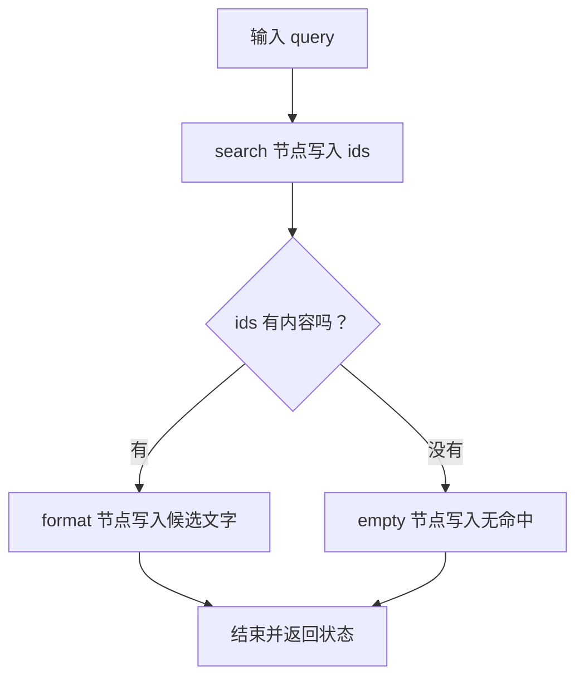
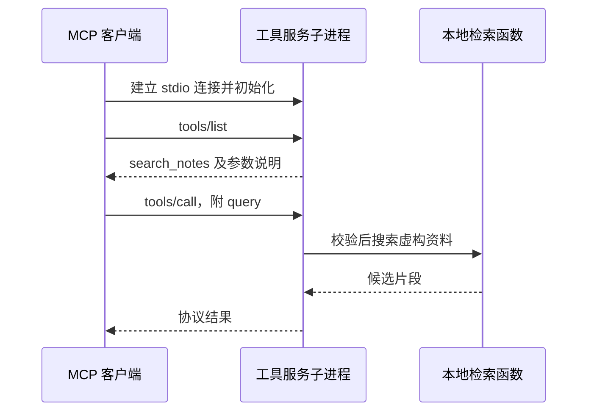

# 10. 框架与 MCP：哪些东西值得交给现成工具？

## 已经能写循环，为什么还会需要框架？

第 04 章的循环很短，你能看懂每一步。以后增加分支、等待确认、恢复任务时，状态和路径会变多。框架可以把这些重复结构组织起来，但不会自动决定需求是否合理、工具是否可信、回答是否正确。

可以这样类比：Agent 循环是你自己安排工序；图框架提供工序表和状态传递机制；MCP（Model Context Protocol，模型上下文协议）则规定不同工具服务怎样递交目录和结果。它们解决的是不同层的问题。

| 名称 | 主要职责 | 本章实际验证 |
|---|---|---|
| 普通 TS 函数 | 直接表达查询与分支 | 一段固定检索流程 |
| LangGraph | 用节点、边和状态组织执行 | 相同流程改成图，比较输出 |
| MCP | 客户端与工具服务之间的协议 | 发现工具、传参数、获取结果 |
| 模型 | 根据输入生成内容或动作请求 | 本章不接模型；第 03～04 章已练 |

## 第一个实验：把已经懂的流程画进代码

继续在自己的 `note-agent-lab` 操作，复用上一章的 `retrieval.ts`。先安装本章才需要的依赖：

```bash
npm install --save-exact @langchain/langgraph@1.7.3 @modelcontextprotocol/sdk@1.32.2 zod@4.6.7
```

新建 `graph-demo.ts`：
<!-- file: graph-demo.ts -->
```ts
import assert from 'node:assert/strict';
import { Annotation, StateGraph, START, END } from '@langchain/langgraph';
import { search } from './retrieval.ts';

const State = Annotation.Root({
  query: Annotation<string>(),
  ids: Annotation<string[]>(),
  answer: Annotation<string>(),
});
type StateValue = typeof State.State;
const find = (state: StateValue) => ({ ids: search(state.query, 'expanded').map(x => x.id) });
const format = (state: StateValue) => ({ answer: `候选笔记：${state.ids.join(', ')}` });
const empty = () => ({ answer: '当前没有命中' });

const graph = new StateGraph(State)
  .addNode('search', find)
  .addNode('format', format)
  .addNode('empty', empty)
  .addEdge(START, 'search')
  .addConditionalEdges('search', state => state.ids.length ? 'format' : 'empty')
  .addEdge('format', END)
  .addEdge('empty', END)
  .compile();

for (const query of ['失败后再试一次', '火星城市人口']) {
  const base = { query, ...find({ query, ids: [], answer: '' }) };
  const plain = base.ids.length ? format({ ...base, answer: '' }) : empty();
  const result = await graph.invoke({ query });
  assert.equal(result.answer, plain.answer);
  console.log({ query, plain: plain.answer, graph: result.answer });
}
console.log('同一固定工作流的普通函数与 LangGraph 输出一致；本实验没有模型决策。');
```

运行：

```bash
node graph-demo.ts
```

它会对“失败后再试一次”和“火星城市人口”分别运行普通函数和真实 LangGraph，断言结果一致。



打开 `graph-demo.ts`，先找到这三组对应关系：

- `State`：节点之间共享的数据形状，包含 `query / ids / answer`。
- `find / format / empty`：普通函数，返回本节点产生的状态更新。
- `addEdge / addConditionalEdges`：规定接下来执行哪个节点。

`graph.invoke({ query })` 启动执行，返回包含结果的状态。这个流程的路径由程序预设，所以它是工作流；用了 Agent 框架，不会使它自动成为模型决策的 Agent。

本例没有接持久化检查点，也不演示人工中断恢复。若项目需要这些能力，应分别实现、测试，再列为已有功能。框架官方快速入门给出了状态、工具和条件边的组合方式，本例先移除模型变量，让你看清控制流本身。[LangGraph 文档](https://docs.langchain.com/oss/javascript/langgraph/quickstart)

练习：在输入列表中加入“重复”，先确认它能召回三条候选。然后修改 `format`，只展示前两项；普通函数版和图版共用它，结果应一起变化。再增加断言，确认状态仍保留三项 `ids`、回答只列两项，避免原来的两个输入根本没触发新规则。你应能指出业务规则与流程编排分别放在哪里。

## 第二个实验：让工具跨一个进程提供服务

原来模型工具由同一个 Node 进程直接调用。MCP 实验把 `search_notes` 放到一个独立子进程里，客户端通过协议发现并调用它。

依次创建两个文件。服务端提供工具，客户端启动它并验证调用：

<!-- file: mcp-server.ts -->
```ts
import { McpServer } from '@modelcontextprotocol/sdk/server/mcp.js';
import { StdioServerTransport } from '@modelcontextprotocol/sdk/server/stdio.js';
import { z } from 'zod';
import { search } from './retrieval.ts';

const server = new McpServer({ name: 'note-search-lab', version: '0.1.0' });
server.registerTool('search_notes', {
  description: '搜索本实验的虚构笔记，只读。返回候选及分数，不代表已完成问答。',
  inputSchema: { query: z.string().trim().min(1).max(100) },
}, async ({ query }) => ({
  content: [{ type: 'text', text: JSON.stringify(search(query, 'expanded')) }],
}));
await server.connect(new StdioServerTransport());
```

<!-- file: mcp-client.ts -->
```ts
import assert from 'node:assert/strict';
import { fileURLToPath } from 'node:url';
import { Client } from '@modelcontextprotocol/sdk/client/index.js';
import { StdioClientTransport } from '@modelcontextprotocol/sdk/client/stdio.js';

const client = new Client({ name: 'note-search-check', version: '0.1.0' });
const transport = new StdioClientTransport({
  command: process.execPath,
  args: [fileURLToPath(new URL('./mcp-server.ts', import.meta.url))],
});
try {
  await client.connect(transport);
  const menu = await client.listTools();
  assert.deepEqual(menu.tools.map(x => x.name), ['search_notes']);
  console.log('远端工具：', menu.tools.map(x => x.name));
  const result = await client.callTool({ name: 'search_notes', arguments: { query: '失败后再试一次' } });
  assert.equal(result.isError, undefined);
  assert.ok(Array.isArray(result.content));
  const block = result.content[0];
  assert.equal(block.type, 'text');
  assert.equal(JSON.parse(String(block.text))[0].id, 'retry');
  console.log('通过 MCP 协议获得：', block.text);
  const invalid = await client.callTool({ name: 'search_notes', arguments: { query: '' } });
  assert.equal(invalid.isError, true);
  console.log('空参数被拒绝。此实验验证协议，不验证模型是否会选对工具。');
} finally {
  await client.close();
}
```

```bash
node mcp-client.ts
npm run typecheck
```

预期看到工具名、包含 `retry` 的结果，以及“空参数被拒绝”。这一过程确实运行 SDK 和两个进程，不调用云端模型。



`mcp-server.ts` 用 `registerTool` 注册名字、描述和 Zod 参数约束，`mcp-client.ts` 用 `listTools/callTool` 请求目录与执行。`stdio` 使用子进程的输入输出传输消息，因此服务端不能随意向 stdout 打印普通调试文字；调试信息应走 stderr。

本实验固定 `@modelcontextprotocol/sdk` **1.32.2**，采用 v1 的深层导入路径。官方也有其他版本文档，跟练时用锁文件和匹配版本的示例，不能混拼不同版本导入。[v1 服务端](https://ts.sdk.modelcontextprotocol.io/server)、[v1 客户端](https://ts.sdk.modelcontextprotocol.io/client)

## MCP 没有替你完成什么？

MCP 服务列出工具，模型 API 接受工具定义，二者还需要宿主程序连接起来：转换 Schema、处理模型选择、转发调用、把结果传回模型。这个适配器本章尚未实现，所以不要把实验写成“模型已通过 MCP 自主检索”。

协议也不等于授权。这里提供本地只读虚构资料；远程服务仍要处理身份、资源权限与部署。本章先把跨进程的边界跑清楚。

同样，多 Agent 应用是另一项架构选择。只有单个流程出现明确的职责、上下文或并行瓶颈时再评估它。让多个编程 Agent 帮你写代码，则在协作附录，与产品内部是否多 Agent 无关。

合上文档，用“谁保存状态、谁规定路径、谁执行工具、谁做模型决策”解释两个实验。能讲清这些对象，比记住多个框架名称更有用。

下一章：[让长任务可靠执行](./11-Agent服务化与可靠执行.md)。
