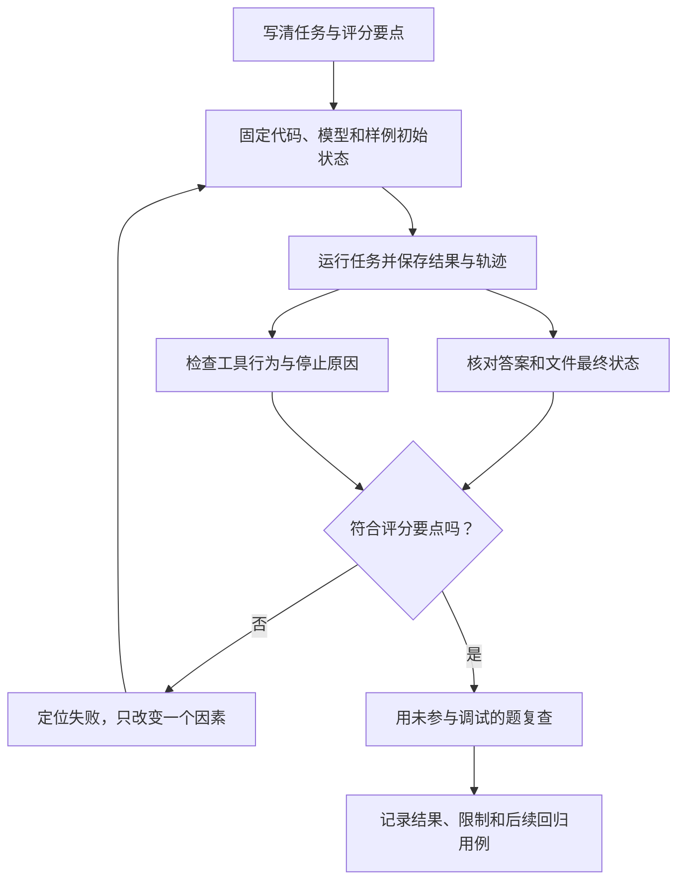

# 10. 评估结果并完成一次交付

## 程序能跑，和助手有用，是两次考试

自动售货机能正确接收钱、转动货道，不代表它装的就是顾客想买的商品。

程序测试检查执行机制：参数是否校验、工具失败是否反馈、未确认能否写入。模型评估检查任务效果：找的资料对不对、结论有无依据、建议是否保留原意。

两种检查一起做，才能知道问题出在工具、流程还是模型行为。



左右两路都要看。答案说“已经修改”时，右侧轨迹与文件状态可以揭示其实只生成了建议；工具顺序与示范不同，但证据和结果正确时，也不应机械判错。

## 第一步：确认程序约束

```bash
npm run check
npm run demo
npm run demo:failure
```

配套项目的离线测试覆盖路径限制、建议与确认、版本变化、工具反馈、轮次上限、HTTP 响应处理，以及 CLI 成功或失败后的日志落盘。演示还会实际走过临时笔记的搜索、读取、建议和确认写入；失败演示用于观察请求失败和轮次耗尽。

这些检查不调用真实模型。通过后可以说“这些场景的程序行为符合预期”，还不能说“模型总能答对问题”。

## 第二步：用同一套题比较真实表现

打开[用例与记录](./evals/用例与记录.md)，先用开发组的 6 个任务建立基线，另外 2 个先保留用于复查。每个任务写明预期事实、禁止发生的行为，以及怎样观察。

例如：

> 事务与重试有什么关系？请引用相关笔记。

通过标准是同时读到相关资料，说明事务保证多步修改整体完成，但不能自动解决重复请求；不能只因为答案出现“事务、重试”就通过。

这像开放题的评分要点：不要求学生逐字背标准答案，但关键事实和推理要成立。

第一次先逐个查看轨迹和答案。改模型、提示词或工具说明后，再跑同一组任务，才容易判断改变有没有帮助。对于表现不稳定的用例，可以重复运行并分别记录，不能只挑最好的一次。

OpenAI 的评估指南建议尽早建立任务相关的评估，并用人工判断校准评分；本例将它落实成开发前写评分要点、修改后跑同组任务，而不是只问“看起来聪明吗”。[评估指南](https://developers.openai.com/api/docs/guides/evaluation-best-practices)

评分时区分三类证据：文件是否被改写可用程序检查，解释是否保留原意由人对照原文判断，工具轨迹帮助定位过程问题。Anthropic 的评估文章也强调结果状态与多次尝试，并提醒不要把唯一工具顺序当成正确答案。[Agent 评估原文](https://www.anthropic.com/research/demystifying-evals-for-ai-agents)

每次涉及写入的尝试都从新的笔记副本开始。否则上一次的修改会成为下一次的输入，像用已经写过答案的试卷重考，会把环境差异误当成模型差异。

## 第三步：按失败位置修

| 看到的现象 | 先检查哪里 | 本项目可以尝试什么 |
|---|---|---|
| 资料存在但搜不到 | 关键词与搜索返回 | 使用更短的关键词，检查字面匹配限制 |
| 搜到了却答错 | 是否读了全文，是否丢失限定条件 | 检查工具轨迹，改善任务说明 |
| 一直换词搜索 | 工具反馈和停止条件 | 缩小问题、检查重复动作；保留轮次上限 |
| 修改建议定位失败 | old_text 是否准确且唯一 | 重新读取当前内容，使用完整原文片段 |
| 声称已修改但只有建议 | 回答与实际操作是否一致 | 修正指令并加入该失败用例，程序继续保留确认边界 |

不要遇到每一种失败都先换更贵的模型。索引找错、工具说明含糊、接口格式错误，都需要在对应位置修。

## 第四步：看轨迹与成本

CLI 会输出执行记录文件名。日志包含模型名、时间、命令、每轮耗时、工具名、成功或失败，以及 API 返回的 token 用量；没有记录 Key、任务原文或笔记全文。

`outcome` 的 `continue / answer / error` 表示这一轮怎样结束，`errorCode` 帮你区分模型请求失败、空回答和轮次上限。请求失败的那一轮也会留下记录，不会消失在成功轨迹后面。

运行记录中的 `status: completed` 只表示程序正常返回了答案；`verification: not_evaluated` 提醒你它还没有经过效果评分。这个轻量日志没有正文和工具参数，不能完整重放任务，评估时仍需另记用例编号和必要证据。

OpenAI 的 Agent evals 指南也从轨迹入手排查行为，再用明确的任务标准反复评估。本例保留轻量日志，先练会定位哪一轮出了问题，不要求接入评估平台。[Agent evals 指南](https://developers.openai.com/api/docs/guides/agent-evals)

动手时先看 `demo:failure` 的两段输出：工具失败后是否还有下一轮，最终又因什么停止？再打开 `test/cli.test.ts`，看它如何用模拟响应验证“正常结束”和“效果未评分”可以同时成立。

建议先记录四项：

- 每个用例是否通过，失败是什么。
- 完成任务用了几轮。
- 总等待时间。
- 输入和输出 token 总量。

token 可以粗略理解成模型处理文本的计量单位，不能固定等同于字数。本例不内置价格表；费用应按运行时的模型价格和账单核对。轮次少也不一定便宜，一轮塞入大量内容同样会增加输入。

## 第五步：交付一个别人能复现的结果

在独立练习仓库中准备：

1. 可安装的代码与锁文件。
2. README 中的启动、配置和示例命令。
3. 离线检查的实际结果。
4. 真实模型评估的模型名、日期、用例与结果。
5. 当前限制：顶层 Markdown、字面搜索、单任务上下文、手动确认写入。

如果真实模型没测，就明确写“未测”。如果 CI 模板还没在 GitHub 运行，也不能用本地通过替代云端运行记录。

用户能完成什么，才是交付结论。分支数、Agent 数、PR 数和代码行数都不能替代这份说明。

## 两条学习线在这里汇合

你可以让开发 Agent 帮忙补测试、改善工具说明，使用 Worktree 分开处理独立任务。然后用同一套用例检查它们共同开发出的笔记助手。

```text
人定义需求与验收
→ 开发 Agent 实现和检查
→ 集成代码并验证程序
→ 笔记助手调用真实模型执行任务
→ 人核对效果，失败案例进入下一轮任务
```

开发 Agent 的数量可以增加，验收依据仍然需要清楚。

## 最后一次复述

不用“智能”“自动化”“赋能”这些词，向朋友解释你的程序：用户输入什么，模型如何选择工具，谁读文件，怎样停止，谁确认写入，怎样证明做对了。

解释卡在某一步，就回到对应章节：调用链看 06～07，上下文看 08，写入看 09，协作和交付看 01～05。

完成后可以选一条扩展：递归目录、检索改进或简单 Web 界面。每次仍从一个用户动作和一组验收例子开始。
