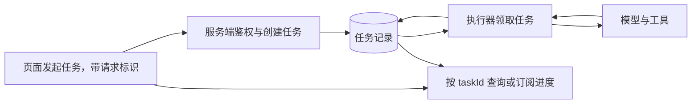
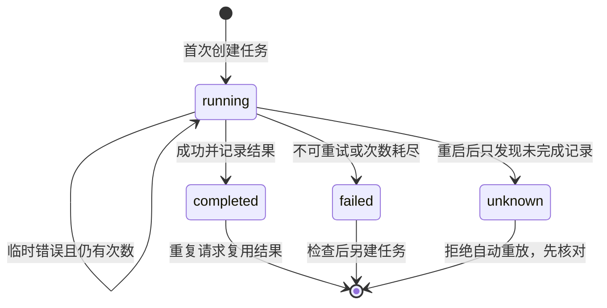

# 11. 可靠执行：请求断了，Agent 的任务怎么办？

## 网页的一次请求，装不下所有任务状态

你熟悉的短接口通常是“请求 → 读写数据 → 返回”。Agent 可能要连续调用模型和工具，耗时较长。浏览器断开、服务重启、用户重复点击，都可能发生在中途。

可以把它想成外卖订单：你关掉查看进度的页面，订单不应凭空消失；你重复刷新，也不应再下三单。因此要把**任务身份和执行状态**从那一次 HTTP 连接中分离出来。

下面是服务化时可能采用的结构图，不是本仓库已经实现的 Web 服务：



这里的用户身份检查、任务表、执行器、进度查询，很多是你已有的后端知识。Agent 增加的难点是：中间步骤由模型参与选择，失败后不一定能安全地重放整条链。

## 先做一个不依赖服务器的可靠执行实验

本章继续使用自己的练习目录和第 09 章的 `retrieval.ts`。先创建 `reliability.ts`，实现任务键、状态记录与有限重试：

<details>
<summary>展开 reliability.ts 完整内容</summary>

<!-- file: reliability.ts -->
```ts
import { mkdir, readFile, rename, writeFile } from 'node:fs/promises';
import { join } from 'node:path';
import { randomUUID } from 'node:crypto';

export class TransientError extends Error {}
export class UncertainTaskError extends Error {}
export type Task = {
  key: string; input: string; status: 'running' | 'completed' | 'failed';
  attempts: number; result?: string;
};

// 一个进程、一个实例拥有目录；不提供跨进程锁，也不保证外部副作用恰好一次。
export class TaskRunner {
  private active = new Map<string, { input: string; promise: Promise<string> }>();
  readonly directory: string;
  constructor(directory: string) { this.directory = directory; }
  private file(key: string) { return join(this.directory, `${key}.json`); }
  private async save(task: Task) {
    await mkdir(this.directory, { recursive: true });
    const temp = join(this.directory, `${randomUUID()}.tmp`);
    await writeFile(temp, JSON.stringify(task, null, 2));
    await rename(temp, this.file(task.key));
  }
  private async load(key: string): Promise<Task | undefined> {
    try {
      const value = JSON.parse(await readFile(this.file(key), 'utf8'));
      if (!value || value.key !== key || typeof value.input !== 'string' ||
          !['running', 'completed', 'failed'].includes(value.status) ||
          !Number.isInteger(value.attempts) || value.attempts < 0 ||
          (value.status === 'completed' && typeof value.result !== 'string')) throw new Error('任务记录损坏');
      return value;
    } catch (error) {
      if ((error as NodeJS.ErrnoException).code === 'ENOENT') return undefined;
      throw error;
    }
  }
  run(key: string, input: string, operation: () => Promise<string>, maxAttempts = 2): Promise<string> {
    if (!/^[a-zA-Z0-9_-]{1,64}$/.test(key) || !input.trim() || !Number.isInteger(maxAttempts) || maxAttempts < 1 || maxAttempts > 5) {
      return Promise.reject(new Error('任务参数无效'));
    }
    const current = this.active.get(key);
    if (current) return current.input === input ? current.promise : Promise.reject(new Error('同一任务键对应了不同输入'));
    const promise = this.execute(key, input, operation, maxAttempts).finally(() => this.active.delete(key));
    this.active.set(key, { input, promise });
    return promise;
  }
  private async execute(key: string, input: string, operation: () => Promise<string>, maxAttempts: number) {
    const previous = await this.load(key);
    if (previous) {
      if (previous.input !== input) throw new Error('同一任务键对应了不同输入');
      if (previous.status === 'completed') return previous.result!;
      if (previous.status === 'running') throw new UncertainTaskError('上次任务的结果未知，请先核对，不能自动重放');
      throw new Error('任务已失败；检查原因后用新任务键重试');
    }
    const task: Task = { key, input, status: 'running', attempts: 0 };
    for (let attempt = 1; attempt <= maxAttempts; attempt++) {
      task.attempts = attempt;
      await this.save(task);
      let result: string;
      try {
        result = await operation();
        if (typeof result !== 'string') throw new Error('任务结果必须是字符串');
      } catch (error) {
        if (error instanceof TransientError && attempt < maxAttempts) continue;
        await this.save({ ...task, status: 'failed' });
        throw error;
      }
      await this.save({ ...task, status: 'completed', result });
      return result;
    }
    throw new Error('没有得到任务结果');
  }
}
```

</details>

然后创建 `reliability-demo.ts`，用真实断言检查四种行为：
<!-- file: reliability-demo.ts -->
```ts
import assert from 'node:assert/strict';
import { mkdtemp, rm, writeFile } from 'node:fs/promises';
import { tmpdir } from 'node:os';
import { join } from 'node:path';
import { TaskRunner, TransientError, UncertainTaskError } from './reliability.ts';
import { search } from './retrieval.ts';

const directory = await mkdtemp(join(tmpdir(), 'agent-tasks-'));
try {
  const runner = new TaskRunner(directory);
  let calls = 0;
  const operation = async () => {
    if (++calls === 1) throw new TransientError('模拟一次临时读取失败');
    return JSON.stringify(search('事务').map(x => x.id));
  };
  const results = await Promise.all([runner.run('q1', '事务', operation), runner.run('q1', '事务', operation)]);
  assert.equal(calls, 2);
  assert.equal(results[0], results[1]);
  const reopened = new TaskRunner(directory);
  assert.equal(await reopened.run('q1', '事务', async () => { throw new Error('不应再次执行'); }), results[0]);
  await assert.rejects(reopened.run('q1', '缓存', operation), /不同输入/);
  await writeFile(join(directory, 'q2.json'), JSON.stringify({ key: 'q2', input: '事务', status: 'running', attempts: 1 }));
  await assert.rejects(reopened.run('q2', '事务', operation), UncertainTaskError);
  console.log({ results, calls, reopened: '复用完成结果', unfinished: '结果未知，拒绝自动重放' });
  console.log('只读任务实验通过；临时目录已安排清理。没有测试外部写入或多进程竞争。');
} finally { await rm(directory, { recursive: true, force: true }); }
```

运行：

```bash
node reliability-demo.ts
```

实验只执行只读检索，使用临时目录保存 JSON 任务记录，并在结束后清理。它验证四件事：

1. 同一个任务键和输入同时提交两次，共用一个执行结果。
2. 第一次模拟临时故障，第二次成功，总调用次数为 2。
3. 新建执行器实例后，能读取已完成结果，不重新执行。
4. 磁盘上只有 `running` 的旧记录时，报告结果未知，拒绝自动重放。

打开 `reliability-demo.ts` 先看断言，再读 `reliability.ts`。前者说明期望行为，后者才是实现方式。

## 三个概念分别解决什么？

**持久化**把任务记录留在内存之外。实验保存 `key/input/status/attempts/result`，重新创建实例后仍能读到已完成结果。保存到文件只是课堂版本，不能据此宣称具备数据库事务或掉电耐久性。

**幂等键**用来识别同一项请求。实验把同键同输入视为同一任务；同键不同输入拒绝，避免把“查事务”的结果错误返回给“查缓存”。这解决请求去重，但没有让任何外部副作用自动变成“恰好一次”。

**有限重试**只针对明确标记的临时失败。`TransientError` 才会重试，默认最多两次；字段错误等普通异常立即失败。实验为了直观看到次数不加延迟，真实网络重试通常还需退避、抖动、限流和总时限。



`unknown` 是恢复时的判断，不是本例新增的磁盘字段。原记录仍是 `running`，执行器抛出 `UncertainTaskError`，提醒调用方处理不确定状态。

## 为什么不能看到 running 就再跑一遍？

假设工具已经发出了邮件，进程在保存成功状态前崩溃。重启时只能看见 `running`。直接重跑可能发第二封；直接标成功又可能在第一次根本没发出时撒谎。

所以恢复不能只看本地状态名，还要核对外部操作是否发生。可用的方案取决于外部系统是否提供幂等键、操作查询或事务支持。这个只读实验用“拒绝自动重放”暴露问题，没有实现邮件补偿或通用工作流恢复。

这是 Agent 工程的一条实用边界：模型可以建议下一步，重试和授权规则仍由程序负责。第 06 章把“生成建议”与“执行写入”拆开，也是同一个道理。

## 从课堂实验到生产服务，还要补哪些实际工程？

| 本例已做 | 真实服务需要再验证 |
|---|---|
| 单进程、单实例内去重 | 多 worker 的领取互斥、数据库约束和并发故障 |
| JSON 文件保存记录 | 可靠数据库、迁移、备份和恢复策略 |
| 本地虚构只读检索 | 用户与资源权限、租户隔离、工具授权 |
| 有限立即重试 | 超时、取消、退避、限流、预算与告警 |
| CLI 输出状态 | HTTP 接口、进度展示、部署与运行观察 |

不用为了本章一次学完 Kubernetes。先用现有 Web 技术做一个真正可查询状态的后台任务，再按业务规模选择部署方式。高级 Infra 岗位提出的容器和分布式要求，则需要独立的长期实践。

动手时先读演示中的 `calls` 断言：临时错误发生一次，随后成功，因此总共执行两次。在恢复完成结果的断言后，加入 `await reopened.run('q3', '事务', operation)`，再断言 `calls` 等于 3。同样的输入换了任务键，会被视为新任务；同键同输入才复用已有结果。观察后恢复。

复述：重复请求、临时失败、未知结果为什么不能使用同一种“再试一次”？

下一章：[用评估证明改进](./12-用评估证明Agent改进.md)。
