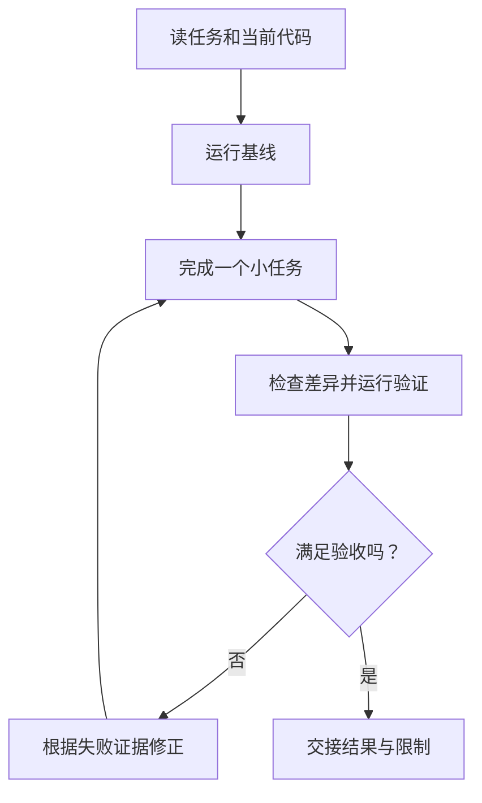

# 附录 B. 验证编程 Agent 的结果，并完成交接

先验收一个编程 Agent 的任务，再考虑多会话并行。像一条生产线还没调好时，同时开十条只会增加待检查的零件。

## 从可复现的起点开始

在自己的 `note-agent-lab` 中执行：

```bash
npm ci
npm run check
node demo.ts
```

`npm ci` 使用第 02 章安装时生成的锁文件；`check` 依赖第 07 章已经写好的测试。演示使用脚本模型，没有真实效果结论。

记录基线，再让编程 Agent 完成附录 A 的小任务。基线本来失败时，先说明原因，避免把旧问题算成这次改动导致的。



图中修正必须有新证据或新假设，不能无限重复“继续修”。

## 看证据，不能只听“搞定了”

检查新增测试是否真的使用空白词和 101 个字符，是否等待异步拒绝，以及是否只修改了约定文件。

在独立练习副本里临时去掉搜索的长度限制，测试应该失败。随后立即恢复并重新检查。这像试烟雾报警器：灯亮不等于发生烟雾时能报警。

## 交接直接写在任务记录里

不用维护独立模板文件，保留这些信息即可：

```text
目标与当前状态：
工作目录、分支、修改文件：
运行过的命令及实际结果：
证据证明了什么：
没有验证什么：
未完成的问题、下一步假设：
接手后先运行哪个命令：
```

不写入 Key 或私人正文。比如本次通过搜索输入测试，仍然没有验证模型是否会选对关键词。

换会话后，让接手者先核对目录和差异，再运行基线；不能直接相信上一轮口头结论。长任务交接的作用是保存可核对的工作状态，不是把完整聊天复制一遍。[Anthropic 长任务实践](https://www.anthropic.com/research/effective-harnesses-for-long-running-agents)

复述：为什么“AI 写了测试，并且说通过”还不够？如果测试根本没有触发要检查的失败，它提供了什么证据？

下一篇：[Git Worktree 并行开发](./C-GitWorktree并行开发.md)。
