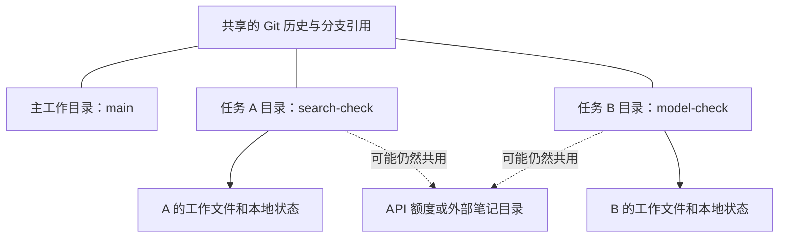

# 附录 C. 用 Git Worktree 准备独立开发目录

本篇属于开发协作附录，不是笔记助手内部的执行机制。

## 分支和 Worktree 有什么区别？

把 Git 仓库想成一本记录设计变更的总账。

- 分支是账本上的一条开发线，记录哪些提交先后发生。
- Worktree 是摆放当前代码的另一张工作台，可以检出另一条分支。

只有不同分支名，却让两个 Agent 轮流在同一个目录 `git switch`，仍然是在抢一张桌子。一方切换文件，另一方正在运行的任务可能读到变化后的内容。

Git Worktree 让多个工作目录共享仓库历史，各自保留工作文件和索引。它不是容器，也不会自动分配独立数据库或端口。[Git 官方说明](https://git-scm.com/docs/git-worktree)



实线看各工作台自己的文件，虚线看仍可能共享的外部资源。排查干扰时，两部分都要检查。

## 第一步：使用你自己跟练的独立项目

主线第 02 章已经在仓库外创建了 `note-agent-lab`，本章直接使用它。先完成第 07 章测试，不需要从学习仓库复制另一套代码。

```bash
cd "$HOME/Desktop/note-agent-lab"
npm run check
```

只在这个独立练习目录初始化 Git，不在 learning-notes 中创建练习分支。已有 Git 历史时跳过初始化，先检查当前分支与改动。

首次初始化时执行下面三条命令。这是读者练习步骤，不表示编写本系列时已经替你执行。

```bash
git init -b main
git add .
git commit -m "chore: 初始化笔记助手练习"
```

此时 `git status --short` 应为空。如果 Git 提示缺少用户名和邮箱，先按你的身份配置，不要直接复制别人的身份。

## 第二步：为两个任务准备独立目录

仍在 `note-agent-lab` 执行：

```bash
git worktree add -b codex/search-check ../note-agent-search
git worktree add -b codex/model-check ../note-agent-model
git worktree list
```

你应看到三个目录：原来的 `main` 工作目录，以及两个任务目录。分别进入后安装依赖：

```bash
cd ../note-agent-search
npm ci
git branch --show-current
```

另一个终端进入 `note-agent-model`，也执行 `npm ci`。把每个编程 Agent 的工作目录明确设为自己的任务目录，而不是只在提示词中提一个分支名。

## 什么被隔离了，什么没有？

| 对象 | 本例中的情况 |
|---|---|
| 项目根目录的 `.ts` 文件与 `notes/` | 各工作目录有自己的副本 |
| `node_modules/`、`.env` | 不在 Git 中，需要各目录准备 |
| `.proposals/`、`.runs/` | 相对当前目录保存，各目录分别生成 |
| Git 提交历史 | 共用仓库对象和分支引用 |
| API 账号额度 | 如果使用同一个 Key，仍共用额度 |
| 外部笔记目录 | 如果 NOTES_DIR 都指向同一绝对路径，仍然共享 |

以后加 Web 界面时，两个进程如果都监听同一个端口，还会冲突。工作台独立不代表电源、仓库和运输通道也自动独立。

第一轮使用各自的样例目录和临时测试文件，就能减少这些共享状态。

## 第三步：检查与收尾

在每个目录执行：

```bash
git status --short
npm run check
```

任务交付、结果已经按附录 D 集成或确认不再需要后，回到 `note-agent-lab` 清理工作目录：

```bash
git worktree remove ../note-agent-search
git worktree remove ../note-agent-model
```

有未提交内容时，Git 通常会拒绝移除。先检查和保存需要的内容，不加 `--force` 绕过检查。删除工作目录也不等于删除对应分支历史。

## 合上文档讲一遍

“两个 Agent 使用不同分支，为什么还需要不同工作目录？”再解释为什么 Worktree 不能解决两个进程使用同一数据库的问题。

下一篇：[多个编程 Agent 分工与集成](./D-多个编程Agent分工与集成.md)。
