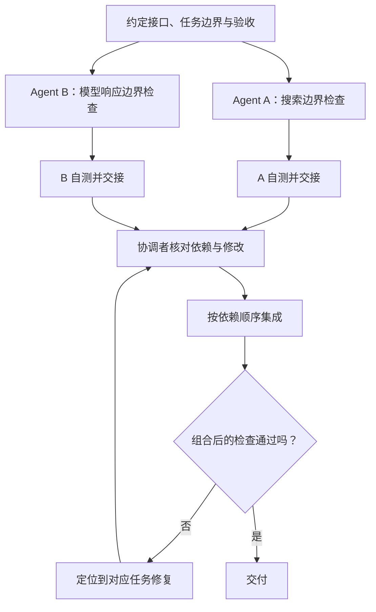

# 附录 D. 多个编程 Agent 怎样分工与集成

本篇属于开发协作附录，不是笔记助手内部的执行机制。

## 并行之前先问：零件能不能分别制作？

两个人可以同时做桌腿和桌面，前提是先约定尺寸和连接方式。如果每个人自己决定，做得再快也可能装不上。

软件里的“连接方式”就是接口契约：输入是什么、输出是什么、失败怎样表示。文件不重叠只是条件之一，行为依赖也要看。



这是“分出去做，再汇合检查”的模式。汇合点必须同时接住两份结果；不能只因为其中一个 Agent 已完成，就跳过另一项验证。

串行适合前一步产出是后一步输入的任务；并行适合可以独立产出、最后再汇总的任务。Microsoft 的编排指南区分了这些模式，也提醒额外协调会带来成本。本章借鉴分工原则，不把应用内部的多 Agent 架构与多个开发会话视为同一个实现。[官方编排指南](https://learn.microsoft.com/en-us/azure/architecture/ai-ml/guide/ai-agent-design-patterns)

## 一个可以直接练的小型分工

使用附录 C 的两个工作目录。下面是留给读者的补充测试练习，不是已经完成的协作记录。

| 任务 | 负责文件 | 验收目标 |
|---|---|---|
| A：补搜索边界测试 | `search-input.test.ts`，新建 | 拒绝空白词与超过 100 字符的关键词 |
| B：补工具批次上限测试 | `agent-limit.test.ts`，新建 | 模型单轮返回 5 个工具请求时，循环拒绝执行，执行器调用次数为 0 |

第 04 章代码已经具备这两条约束。两项任务分别使用无效输入和模拟模型，不需要 API Key，也不需要先修改共享接口，适合第一次练习并行。

如果已完成附录 A 的搜索测试，任务 A 改为审查现有测试，不再重复新增。给每个任务附上附录 A 的输入、范围、验证与交付要求。分别让两个编程 Agent 工作；没有多 Agent 工具时，可以先在两个终端顺序完成，练习的依赖和集成方法相同，但不要把顺序执行记录成并行验证。

## 谁来协调？

第一轮由你协调即可：确定任务、回答接口问题、查看结果、决定集成顺序。任务变复杂后，协调工作可以部分交给主 Agent，但仍需要明确由谁判断验收。

交接至少包含：

```text
改了哪个文件？
哪个命令证明了哪个行为？
还有什么没验证？
是否依赖别的任务先合并？
```

“搞定了”无法让下一位接手。“新增一个失败场景测试，证明超限时没有执行任何工具”才描述了实际结果。

## 两个任务怎样汇合？

在各自目录先检查差异、运行 `npm run check`，再由你决定是否创建练习提交。只暂存本任务的新文件。

```bash
# 任务 A 目录，完成文件后执行
git add search-input.test.ts
git commit -m "test: 验证搜索输入边界"
```

任务 A 只审查且没有产生修改时，跳过它的提交与合并。任务 B 同理，只暂存 `agent-limit.test.ts`。之后回到独立仓库的 `main` 工作目录：

```bash
git switch main
git merge --no-ff codex/search-check
npm run check
git merge --no-ff codex/model-check
npm run check
node demo.ts
```

发生冲突时先停下，读懂双方要保护的行为，再处理文件，不能只选“全部保留我的版本”。这里是本地练习；使用 GitHub 时，把直接合并换成 PR 流程，见附录 E。

## 实际功能开发的依赖怎样处理？

假设后续给搜索结果新增 `title` 字段：

```text
确定 title 的含义及缺失时的行为
→ 搜索工具实现并验证新字段
→ CLI 展示消费这个字段
→ 集成验证
```

CLI 可以先基于约定的样例开发，但接口改变后仍要联调。不能因为分配了两个 Agent，就把本来有依赖的步骤当作完全独立。

多个 Agent 同时修改 `package.json`、锁文件或核心类型时，最好指定一个任务统一负责这些共享修改。别人把依赖需求写进交接记录。

## 为什么不追求同时开十个？

你的总交付时间还包括等待、审查、冲突处理和集成。两个任务如果不断互相等待，加更多 Agent 可能增加沟通成本。

先记录任务从开始到验收的时间、失败原因和返工次数。PR 数量、生成代码行数只描述产量，不能单独证明交付价值。

## 合上文档讲一遍

两个分支测试都通过，为什么合到一起还要测试？用桌腿和桌面的接口，再换成 `searchNotes()` 返回字段解释一次。

下一篇：[CI 与代码审查](./E-CI与代码审查.md)。
