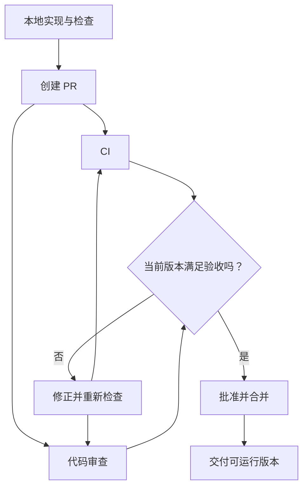

# 附录 E. 用 CI 与代码审查验证交付

## 不同检查回答不同问题

把交付看成出厂检查：尺寸检查、通电试验和人工观察各有用途。类型、测试、审查和用户验收也不能互相替代。

| 检查 | 能说明什么 |
|---|---|
| TypeScript | 已声明的接口类型是否一致 |
| 离线行为测试 | 给定场景下程序是否遵守约束 |
| AI 与人工审查 | 实现逻辑和遗漏是否值得修正 |
| 真实模型评估 | 用户任务是否完成、内容是否有据 |

让同一个模型再说一次“没问题”，并没有增加实际运行证据。

## 先运行自己项目已有的检查

```bash
npm run check
node demo.ts
```

这两条命令来自主线第 02、04、07 章。小型 CLI 没有打包步骤，也未配置 Lint，因此不能写成这些检查已通过。

## 把检查搬到干净环境：CI

CI 即持续集成，在代码变化时自动准备环境并运行检查。像一个固定的质检站，减少“只在我电脑上能跑”的差异。

在你自己的 `note-agent-lab` 中创建 `.github/workflows/check.yml`：

<!-- file: .github/workflows/check.yml -->
```yaml
name: quality
on: [push, pull_request]
permissions:
  contents: read
jobs:
  check:
    runs-on: ubuntu-latest
    steps:
      - uses: actions/checkout@v4
      - uses: actions/setup-node@v4
        with:
          node-version: '24'
          cache: npm
      - run: npm ci
      - run: npm run check
      - run: node demo.ts
```

步骤是检出代码、安装 Node、按锁文件安装依赖、检查和运行离线演示。上传独立项目到自己的 GitHub 后才会触发；写出文件不等于云端已运行，也不等于检查被设为合并必需条件。[GitHub Node.js CI 说明](https://docs.github.com/en/actions/tutorials/build-and-test-code/nodejs)

这里不需要模型 Key，真实模型评估另行运行。请保留锁文件并提交自己的实现；本文不会替你推送。

## 审查、合并、发布是不同步骤



PR 是展示修改和讨论的地方，合并是代码进入目标分支；都不自动等于线上部署。本练习的交付可以是可复现的 CLI 与说明。

## 给审查者具体规则

例如审查 `apply.ts` 时要求检查：只有明确 `--yes` 才能写入，当前正文必须等于建议的 `before`。删除这项检查应该被指出；仅修改帮助文字不应受到同一项缺陷指控。[项目审查规则实践](https://developers.openai.com/blog/custom-code-review-rules-for-codex)

审查意见还要与第 06 章的实际拒绝实验对照。代码回滚也不会自动恢复已经修改的笔记，代码版本和数据状态需要分别处理。

复述：两个分支各自通过检查，为什么组合后还要检查？一次代码合并又为什么不代表模型效果已通过？

返回：[协作附录](./README.md)。
