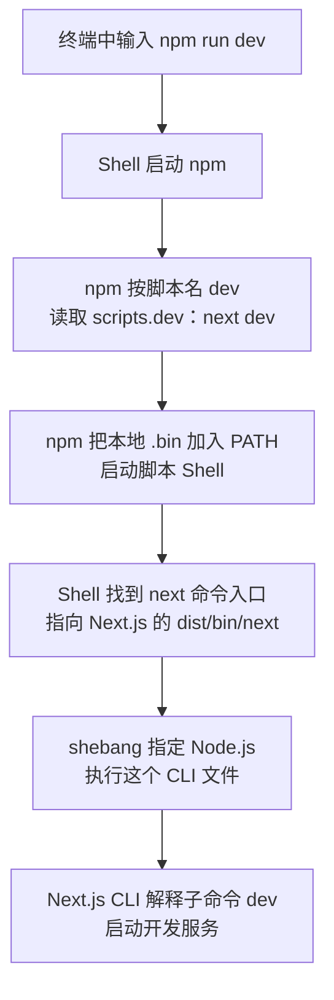

# 01. npm run dev 后面发生了什么

在 MiniCMS 的两个目录里，你都执行过 `npm run dev`。前端启动 Next.js，后端启动 Express。命令一样，为什么结果不同？

先猜一猜：`dev` 是 Node.js 内置命令，还是这个项目自己起的名字？

## 1. npm 先读任务说明

两个 `package.json` 的相关片段如下，省略了其他脚本：

前端 `admin-web-antd/package.json`：

```json
{
  "scripts": {
    "dev": "next dev",
    "build": "next build",
    "start": "next start"
  }
}
```

后端 `server/package.json`：

```json
{
  "scripts": {
    "dev": "tsx watch src/server.ts",
    "start": "tsx src/server.ts"
  }
}
```

`npm run dev` 的意思是：请 npm 执行当前包里名为 `dev` 的脚本。脚本的内容由项目决定，npm 不会因为目录叫“前端”就自动选择 Next.js。

可以把 `package.json` 想成工作室的任务表：

```text
任务名 dev → 要执行的命令 next dev
任务名 build → 要执行的命令 next build
```

npm 按任务名找操作说明，然后准备环境并启动相应命令。两个工程有两张任务表，所以同名任务可以做不同的事。

## 2. next 不是写在 Shell 里的特殊词

Shell 要启动一个命令，首先需要找到可执行文件。`PATH` 是供它查找的一组目录，类似“去这些工具柜里依次找”。

你安装 Next.js 后，这个包在自己的 `package.json` 中声明：

```json
{
  "bin": {
    "next": "./dist/bin/next"
  }
}
```

这表示包提供一个名叫 `next` 的命令，入口是包里的 `dist/bin/next` 文件。npm 在本地安装依赖时，会在 `node_modules/.bin` 建立相应入口；在 macOS 上通常是符号链接。

运行 npm 脚本时，npm 把本地 `node_modules/.bin` 加进该脚本的 `PATH`。所以脚本可以直接写 `next dev`，不用写完整路径，也不用全局安装 Next.js。[npm 对 PATH 和脚本 Shell 的说明](https://docs.npmjs.com/cli/v11/commands/npm-run/)

这里有两个不同问题：

- `scripts.dev` 决定这次要执行什么命令。
- `bin` 和 `PATH` 帮助系统找到这个命令对应的文件。

## 3. 找到文件后，谁来执行里面的 JavaScript

打开你安装的 Next.js CLI，第一行是：

```text
#!/usr/bin/env node
```

这行叫 shebang。macOS/Linux 执行这个入口文件时，会按它指定的方式启动解释器：这里由 `env` 在 PATH 中找到 `node`，让 Node.js 执行该文件。

因此，启动入口可以按下面的图从上往下追。注意两个 `dev` 分别由谁解释：



`dev` 在第一处是 npm 脚本名，在第二处是 Next.js 的子命令。它们恰好同名，但交给了不同程序解释。

这不是逐层拼出一条固定的 `node run ...`。更接近“找到程序 → 选择执行环境 → 把参数交给程序”。`next dev` 内部还可能启动子进程，图中只画入口职责，不把它当完整进程树。

npm 本身也是使用 Node.js 的程序。Node.js 在这条链路中可以运行多个工具，不是只在最后出现一次。[npm 的 bin 入口约定](https://docs.npmjs.com/cli/v11/configuring-npm/package-json/#bin)

## 4. 后端为什么又多了一层 tsx

你的后端启动命令是：

```text
tsx watch src/server.ts
```

可以把 `tsx` 理解为帮助 Node.js 运行 TypeScript 的工具，`watch` 表示监视相关文件，发生变化后重新运行程序。实际入口仍然是 `src/server.ts`，由它导入应用并启动监听。

```text
npm 找到后端的 dev 脚本
→ 启动 tsx
→ tsx 配合 Node.js 加载、转换并执行 TypeScript
→ src/server.ts 调用 app.listen
→ Express 服务开始接收请求
```

Node.js、tsx、Express 可以这样对应：

| 对象 | 比喻 | 实际职责 |
|---|---|---|
| Node.js | 能开工的车间 | 执行 JavaScript，提供文件、进程和网络等能力 |
| tsx | 图纸适配工具 | 让项目中的 TypeScript 模块进入执行流程 |
| Express | 车间里的接单流程 | 根据 HTTP 方法和路径，组织中间件与业务函数 |

比喻的边界是：tsx 和 Express 都是软件。Express 通常运行在 Node.js 进程里，并不是一台独立机器；构建工具还可能调用原生程序，不能把所有内部工作都归为 JavaScript。

## 5. 亲眼检查这条链路

以下命令在你的 Mac 上执行。若 MiniCMS 不在桌面，只替换第一条命令的目录。

```bash
cd ~/Desktop/mini-cms/admin-web-antd
node -p 'JSON.stringify(require("./package.json").scripts, null, 2)'
node -p 'JSON.stringify(require("./node_modules/next/package.json").bin)'
ls -l node_modules/.bin/next
head -n 1 node_modules/next/dist/bin/next
```

依次找出四个证据：脚本内容是 `next dev`；包声明了 `next` 入口；本地命令指向包里的文件；文件首行指定 Node.js。这里的 `node -p` 表示执行一小段 JavaScript 并打印结果，没有启动开发服务器。

再看执行环境：

```bash
command -v node
node -p 'process.execPath'
```

前者显示 Shell 找到的 node，后者显示当前 Node.js 进程所用的可执行文件。使用版本管理工具时，前者可能经过一个入口或链接，不要求输出文本完全相同。

最后切到后端：

```bash
cd ~/Desktop/mini-cms/server
node -p 'JSON.stringify(require("./package.json").scripts, null, 2)'
```

把前后端 `dev`、`start` 的区别用一句话讲出来。这个任务只检查文件，不需要重新安装依赖或启动第二份服务。

## 6. 开发启动、构建和生产启动各做什么

你的前端中：

```text
next dev：在开发中提供页面，编译所需代码并支持更新反馈
next build：生成供生产运行使用的构建结果
next start：用已有构建结果提供生产服务
```

`build` 通常完成任务后退出，`dev` 和 `start` 启动的服务则需要持续等待请求。后端当前的 `start` 仍是 `tsx src/server.ts`，并没有先生成 `dist` 再运行它；解释项目时要以真实脚本为准。

“现代前端依赖 Node.js”首先常指开发、构建工具依赖它。浏览器最终执行页面里的 JavaScript；Next.js 的服务端部分在你当前的自托管方案中也使用 Node.js。下一章把这些位置分开。

## 7. 合上文档，讲给别人听

1. 为什么两个目录的 `npm run dev` 会执行不同命令？
2. 没有全局安装 next，npm 脚本为什么能找到它？
3. 在终端直接输入 next 提示找不到命令，能否据此认定依赖没有安装？
4. 把后端脚本名改为 `serve`，原来的 `npm run dev` 还能自动猜到它吗？只推理，不必修改项目。

<details>
<summary>讲完后再看提示</summary>

任务表、命令查找、解释器和命令参数分别负责不同步骤。交互式 Shell 的 PATH 不一定包含当前项目的 `.bin`，所以直接运行失败不能单独证明依赖缺失。npm 按脚本名查找，不会根据你的意图猜另一个名称。

</details>

下一章：[同一份 JavaScript 在哪里运行](./02-同一份JavaScript在哪里运行.md)。
