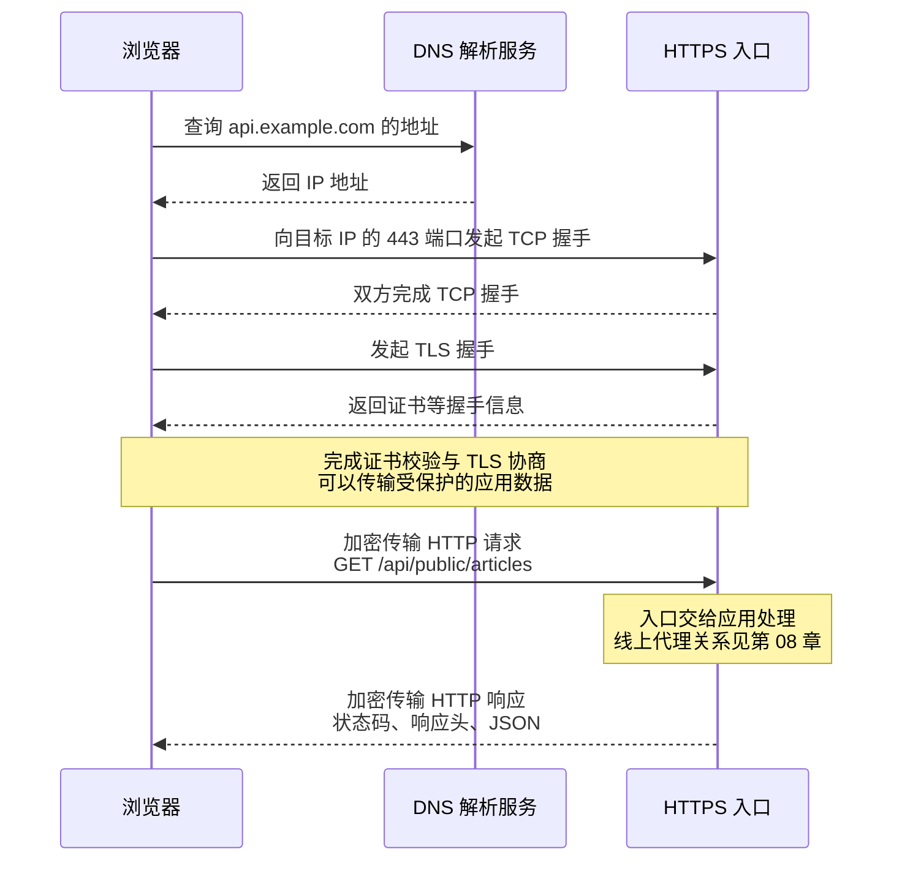

# 04. 一次请求怎样找到你的服务

你在页面中调用 `fetch`，最后进入 Express 路由。两个 JavaScript 函数之间没有直接调用关系，数据凭什么能到达正确的服务？

先把一次请求理解为：找到地址，建立可用的通信，再按约定交换消息。

## 1. URL 把几种不同的信息放在一起

以示意地址为例，`api.example.com` 需要替换成自己的域名才代表真实 MiniCMS：

```text
https://api.example.com/api/public/articles?page=1&pageSize=10
```

| 部分 | 作用 |
|---|---|
| `https` | 选择使用 TLS 保护的 HTTP 通信 |
| `api.example.com` | 要访问的主机名 |
| 隐含的 `443` | HTTPS 的默认端口 |
| `/api/public/articles` | HTTP 请求的目标路径 |
| `page=1&pageSize=10` | 查询参数 |

DNS 不负责解释 `/api/public/articles`，端口也不负责匹配 Express 路由。不同部分在不同阶段被使用。

## 2. DNS 解决“这个名字去哪里找”

域名像联系人姓名，IP 地址像联系地址。DNS 帮助客户端从名字查到地址，例如返回 IPv4 的 A 记录或 IPv6 的 AAAA 记录。

实际查询可能先命中浏览器、系统或 DNS 解析器的缓存，不必每次从头询问。直接访问 `127.0.0.1` 时不需要用公共 DNS 查这个 IP；`localhost` 通常也由本机机制解析。

DNS 查询成功，只证明得到了地址。不能由此证明目标端口开放、证书正确或文章接口存在。

有自己域名时，可以在 Mac 上只读观察：

```bash
# 先把示例域名替换为自己的 API 域名
dig +short api.example.com A
dig +short api.example.com AAAA
```

输出可能包含别名或多个地址。先确认最终地址是否符合你的部署，不要求 DNS 名称必须直接对应单台应用服务器。

## 3. IP 和 TCP 分别解决什么

IP 负责跨网络寻址和传递数据包。对于本轮的 HTTP/1.1 或 HTTP/2 连接，TCP 在它之上提供可靠、有序的字节流。

可以把 IP 想成把一批货送向目的地的运输网络，把 TCP 想成两端负责编号、确认、补发并按序交付的收发员。

建立 TCP 连接时，常听到的“三次握手”是双方交换连接信息、确认通信状态的过程。知道这个阶段发生在 HTTP 业务之前，就已经能解释：连接都没建立，Express 路由自然没有机会执行。

TCP 提供的是字节流，不知道“这一段是标题，那一段是文章正文”。一次发送也不保证对应接收方的一次读取；HTTP 等上层协议需要定义消息的结构和边界。[TCP 规范中的字节流与可靠性](https://www.rfc-editor.org/rfc/rfc9293.html)

这个边界很重要：网络负责传字节，业务程序才理解文章。

## 4. TLS 解决“对方是谁，途中怎样保护数据”

对于基于 TCP 的 HTTPS，新连接通常先建立 TCP，再进行 TLS 握手。客户端检查证书与目标域名等信息，双方协商保护通信所需的参数，随后传输加密的应用数据。

可以把它想成联系到接待窗口后，先核验对方的身份牌，再建立外人看不懂内容的通信方式。

TLS 保护传输中的机密性和完整性，帮助验证服务器身份；它不替 Express 判断“这个人是不是管理员”。管理员身份仍要通过第 07 章的登录凭证确认。

证书校验失败时，不应把关闭校验当作修好问题。先查访问的域名、证书覆盖范围和有效期，以及浏览器实际连接到了哪里。

## 5. HTTP 解决“双方怎样表达请求和结果”

一条简化的 HTTP/1.1 请求可以写成：

```http
GET /api/public/articles?page=1&pageSize=10 HTTP/1.1
Host: api.example.com
Accept: application/json

```

方法表达操作意图，路径定位资源，查询参数补充条件，请求头提供附加信息。上面没有请求体。

服务端返回状态、响应头和可选的响应体：

```http
HTTP/1.1 200 OK
Content-Type: application/json

{"data":[],"pagination":{"page":1,"pageSize":10,"total":0}}
```

这是为了阅读省略部分头的示意报文，不是完整抓包。响应体结构对应 MiniCMS 的公开文章列表；具体数据取决于数据库。

HTTP 状态码属于对方给出的回答。收到 401、404、500 时，先问是哪一层服务返回的，再查认证、路由或业务错误。没有收到 HTTP 响应的连接问题，通常要先往网络方向查。

## 6. 一张分工表串起来

| 你现在要解决的问题 | 对应机制 | 类比 |
|---|---|---|
| 根据名字查地址 | DNS | 查联系人地址 |
| 把包送向目标网络位置 | IP | 运输线路 |
| 可靠、有序地交付字节 | TCP | 编号、确认、补发的收发员 |
| 验证服务器并保护传输 | TLS | 核验证件并加密通信 |
| 表达读取、创建、成功和失败 | HTTP | 双方约定的办事表单 |
| 把请求交给项目里的函数 | Express | 接待处的业务分流 |

把这些职责放进一次 HTTPS 访问中，就能看清先后关系。下图假定需要查询地址、建立新的 TCP 连接，没有复用现成连接；握手箭头概括一段交互，不代表实际只有两个数据包。



这些类比只帮助理解职责。实际网络并不是每个请求都重新做一遍所有动作：DNS 可以缓存，连接可以复用；HTTPS 上的 HTTP/2 可以在一个连接中承载多个请求。

HTTP/3 使用基于 UDP 的 QUIC，不能套用“先 TCP，再 TLS”的分步模型。当前原生 Node.js 实验使用 HTTP/1.1，先把这条线理解透即可。[HTTP 版本与传输方式](https://developer.mozilla.org/en-US/docs/Web/HTTP/Guides/Evolution_of_HTTP)

## 7. 用 curl 把抽象过程露出来

先按上一章启动监听实验，在另一个终端执行：

```bash
curl --http1.1 -v http://127.0.0.1:4311/api/health
```

重点找四类信息，不需要背下全部输出：

1. 正在尝试连接的 IP 和端口。
2. 连接成功的信息。
3. 以 `>` 开头的请求行和请求头。
4. 以 `<` 开头的响应状态和响应头，以及最后的 JSON。

因为使用本地 IP 和 `http`，这次没有公共 DNS 查询和 TLS 握手。这正好隔离出 TCP 连接与 HTTP 交换。

保持服务运行，改为不存在的路径再观察：

```bash
curl --http1.1 -v http://127.0.0.1:4311/missing
```

连接仍成功，但回答变成 404。curl 默认不会仅因 HTTP 404 就把命令视为传输失败；读状态码和错误正文才能判断业务结果。

若已有上线的 MiniCMS，可把自己的 API 域名填入下面变量，再观察 TLS 部分：

```bash
API_HOST=api.example.com
curl --http1.1 -v "https://${API_HOST}/api/health"
```

这一步只访问健康检查，不携带登录 Cookie。`-v` 用于看协议过程；以后观察带凭证请求时，不要把包含凭证的原始日志直接分享出去。

## 8. 回到浏览器里看同一条请求

启动 MiniCMS，打开浏览器 Network，选择一条文章请求，检查：

- Request URL：实际请求了哪个地址？
- Request Method：读取还是修改？
- Status Code：有没有 HTTP 响应？结果是什么？
- Timing：时间主要花在连接、等待响应还是下载上？

等待首字节的时间可能包含网络往返、代理排队和服务端处理，不能把它直接当成 SQL 执行时间。要定位数据库，需要继续结合服务器日志或查询观测。

## 9. 合上文档，讲给别人听

1. DNS 查到了正确地址，为什么接口仍可能失败？
2. 服务器返回 404，能否说“网络完全没通”？
3. HTTPS 已经验证服务器身份，为什么还需要管理员登录？
4. 为什么 TCP 接收的一块数据不必是一份完整 JSON？

<details>
<summary>讲完后再看提示</summary>

每层只保证自己的职责。HTTP 404 证明收到了某个 HTTP 服务的响应，不证明访问了预期的业务路由。TLS 的服务器身份与管理员身份不同。TCP 不保留应用消息边界，需要 HTTP 解析和后续的正文处理。

</details>

继续阅读：[JSON 怎样穿过网络变成 req.body](./05-JSON怎样穿过网络变成req-body.md)。
