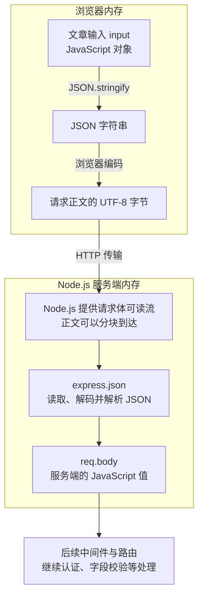

# 05. JSON 怎样穿过网络变成 req.body

前端有一个 `input` 对象，后端拿到一个 `req.body` 对象。它们长得相似，但不在同一个进程，也不是同一块内存。中间发生了什么？

本章沿着“对象 → 文本 → 字节 → 文本 → 对象”往返一次。

## 1. 前端先把内存中的值表示成文本

MiniCMS 的 `admin-web-antd/features/articles/api.ts` 创建文章时使用：

```ts
// 项目中的核心片段，input 是已经组装好的文章输入
return apiRequest<Article>("/api/articles", {
  method: "POST",
  headers: {
    "Content-type": "application/json",
  },
  body: JSON.stringify(input),
});
```

`JSON.stringify` 把可表示的数据转换为 JSON 字符串。浏览器随后把正文编码为字节，组织进 HTTP 请求，再通过连接发送。

可以把 JavaScript 对象看成你桌上的一组物品。别人不能通过网络直接拿走你桌上的内存，你需要先填写双方都能读懂的清单。JSON 就是一种清单格式。

`Content-Type` 是清单上的格式标签，告诉接收方“请按 JSON 理解这份正文”。它不会主动把对象序列化，也不能保证正文一定合法。

## 2. 文本与字节为什么还要分开

网络和文件最终处理字节。UTF-8 则规定字符怎样表示为字节，接收方按相同规则才能恢复文本。

在终端执行：

```bash
node -e 'const text = "文章"; console.log(text.length, Buffer.byteLength(text, "utf8"));'
```

应看到 `2 6`：这个字符串的 JavaScript 长度为 2 个 UTF-16 码元，UTF-8 编码需要 6 个字节。遇到 emoji 等字符时，JavaScript 的 `length` 也不能直接等同于人眼看到的字符个数。

Node.js 的 Buffer 用来处理字节，可以把它想成装着原始数据的一小段货箱。`buffer.toString("utf8")` 才是按 UTF-8 把货箱中的字节解释为文本。

这也解释了 HTTP 的 `Content-Length`：它计算正文的字节数，不是简单使用 JavaScript 字符串的 `length`。浏览器和常见请求库会处理这类协议细节，日常调用 fetch 不需要手动填写。

## 3. 请求到达时，正文可能还没收完

Node.js 的 HTTP 层先识别方法、路径、请求头等信息，创建请求和响应对象，再调用请求处理函数。请求正文可以继续分块到达。

`req` 因此也是一个可读流：程序按到达进度取得数据，直到结束。它不是“创建对象时，所有正文就已经自动完整装好了”。[Node.js IncomingMessage 说明](https://nodejs.org/api/http.html#class-httpincomingmessage)

把流想成传送带：你可以接到一箱，再接到下一箱。箱子大小取决于底层传递情况，不按 JSON 字段切割。

```text
可能先到：{"tit
随后到：le":"文章"}
```

一个 UTF-8 字符也可能跨越两块 Buffer。逐块独立解码再拼接，有机会破坏字符；本章实验先合并 Buffer，再统一解码。另一种做法是使用能够保存跨块解码状态的工具。

这里的 `data` 块不等于一个 TCP 包，也不等于 HTTP/1.1 的 chunked 传输块。三者属于不同层次，不应按数量一一对应。

## 4. express.json 做了什么

MiniCMS 在路由之前注册：

```ts
app.use(express.json({ limit: "1mb" }));
```

对匹配 JSON 内容类型的请求，这个中间件读取正文、执行 JSON 解析，再把解析结果交给后续处理代码使用。把前后端连起来看，跨越网络的是字节，两个对象分别属于各自的内存：



`limit` 限制解析器接受的正文大小。收集完整正文和解析都需要资源，因此容量限制与服务器负载有关，不只是输入框的产品限制。

JSON 解析成功只证明格式可以解析。`{"title":123}` 是合法 JSON，但未必符合文章标题的业务要求。路由里的 `createArticleSchema.parse(req.body)` 继续做字段校验，二者承担不同工作。

在当前 MiniCMS 中，正文解析在来源检查、认证路由和文章路由之前；后面的 `RequestAuth` 再决定请求是否具有管理权限。具体顺序以 `src/app.ts` 的注册顺序为准。

## 5. next 连接的是应用步骤，不是网络连接

可以把中间件看成窗口里的办理工序：先拆清单，再查凭证，再办理业务。`next()` 表示当前工序把控制权交给 Express 继续查找后续处理者。

它不会重新建立 TCP 连接，也不表示为请求新建线程。如果既不继续，也不结束响应，客户端就可能一直等待。遇到错误时，`next(error)` 则进入错误处理流程；Express 5 对异步 handler 的 Promise 失败处理放到下一章。

后端实际顺序的局部示意是：

```text
express.json → cookieParser → 来源检查
→ 受保护路由的 RequestAuth → 文章 Router → repository
```

每一步都在处理同一次请求的上下文。不同请求有各自的 req/res，不能把用户身份放在一个全局变量里让所有请求共用。

## 6. 把 JSON 解析过程拿出来观察

启动[请求体实验](./labs/02-http-body.mjs)：

```bash
node backend/node-network-foundations/labs/02-http-body.mjs
```

在第二个终端发送一份小 JSON：

```bash
curl -i http://127.0.0.1:4312/echo \
  -H 'Content-Type: application/json' \
  --data-binary '{"title":"文章"}'
```

应得到 200，`received` 是恢复后的对象，`bytes` 是收到的正文字节数，`chunks` 是本次读到的块数。服务器终端会显示每块 Buffer 的大小。块数可能是 1，也可能更多，不把固定块数作为成功条件。

实验的核心转换只有三步：

```js
// chunks 是按顺序收集的 Buffer 数组
const bytes = Buffer.concat(chunks);
const text = bytes.toString("utf8");
const value = JSON.parse(text);
```

完整实验只接收本机小请求；它将超过 1024 字节的正文读完后返回 413，超过限制后不再收集内容。它用于观察转换过程，正式应用继续使用 Express 的解析器。

再发送格式不完整的 JSON：

```bash
curl -i http://127.0.0.1:4312/echo \
  -H 'Content-Type: application/json' \
  --data-binary '{"title":'
```

应得到 400。连接、HTTP 和字节接收都可以成功，但 JSON 解析失败。把它与“连接被拒绝”区分开。

最后试试合法 JSON 中的不合适字段类型：

```bash
curl -i http://127.0.0.1:4312/echo \
  -H 'Content-Type: application/json' \
  --data-binary '{"title":123}'
```

实验会返回 200，因为它只回显 JSON，没有文章 Schema。回到 MiniCMS，字段是否接受由它自己的 Zod 规则判断。

## 7. 响应沿着相反方向走

MiniCMS 路由使用：

```ts
res.status(201).json({ data: article });
```

Express 把数据序列化为 JSON，设置相应响应信息，通过 Node.js 写入连接。浏览器再读取响应：

```ts
const response = await fetch(url, options);
const body = await response.json();
```

两个 await 等待的事情不同：第一个得到响应对象时，正文可能还没有全部收到；第二个继续读取正文并解析 JSON。正文通常只能消费一次，读完后再调用一次 `response.json()` 会失败，需要重复使用时保存解析结果。

另一个容易混淆的地方是：fetch 收到 404 或 500 通常仍然取得 Response，不会仅因状态码而 reject。MiniCMS 的 `api-client.ts` 检查 `response.ok`，再主动抛出 `ApiError`。网络失败、解析失败和业务错误应沿不同证据判断。

退出登录返回 204，没有正文，所以项目单独使用 `apiRequestNoContent`；若强行调用 `response.json()`，就会尝试把空正文当 JSON 解析。

## 8. 日志里的 finish 到底证明了什么

MiniCMS 的请求日志监听 `res.on("finish", ...)`。这表示响应已交给底层系统发送，不代表浏览器已完整收到，更不代表 React 已经更新页面。[Node.js ServerResponse finish 事件](https://nodejs.org/api/http.html#event-finish_1)

所以服务端日志的耗时覆盖从相应中间件开始，到响应交付底层的这段流程。前端用户感受到的时间还可能包含后续传输、解析和渲染。

## 9. 合上文档，讲给别人听

1. 前端 input 和后端 req.body 为什么不是同一个对象？
2. Content-Type 写了 JSON，为什么仍可能返回 JSON 解析错误？
3. 为什么不能收到第一块 Buffer 就立刻 JSON.parse？
4. express.json、Zod、RequestAuth 分别在确认什么？
5. 为什么服务端打印响应完成，不等于用户已经看到新文章？

<details>
<summary>讲完后再看提示</summary>

跨进程传递的是表示数据的字节，不是对象引用。格式标签、实际格式、字段规则和权限是不同检查。正文可能分块到达；响应交付底层、客户端收到、解析完成和界面更新也发生在不同时间。

</details>

继续阅读：[等待数据库时 Node.js 在做什么](./06-等待数据库时Nodejs在做什么.md)。
