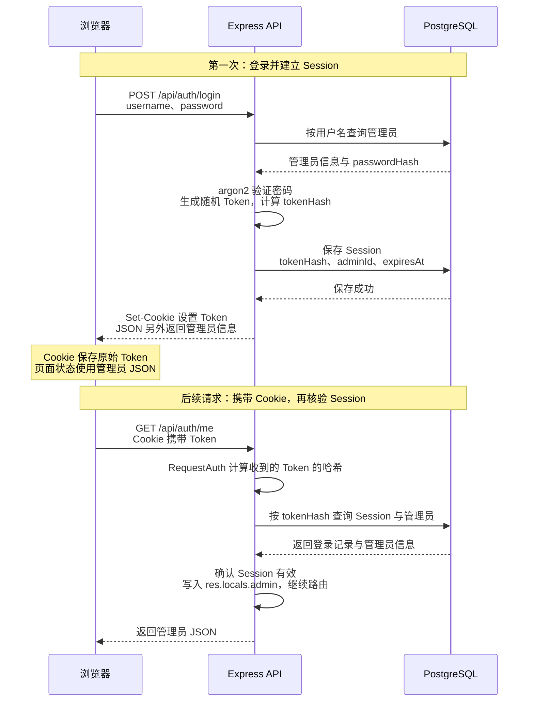
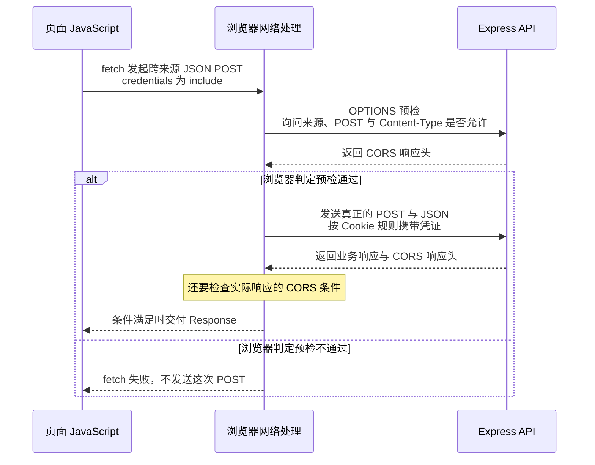

# 07. Cookie 和跨域怎样影响登录

登录请求已经返回成功，为什么下一次文章请求还可能得到 401？浏览器显示跨域错误时，为什么终端 curl 却能读到响应？

需要分开看四件事：服务器怎样认人、浏览器怎样保存和携带凭证、页面能否读取跨来源响应、服务器是否接受这次操作。

## 1. 连接还在，不代表已经登录

HTTP 的一次请求通常需要自己携带服务器判断它所需的信息。TCP 连接可以复用，但连接本身不会自动替应用保存“这个人已经是管理员”的身份。

可以把每次 HTTP 请求想成一次进门办事。门一直开着，不表示接待员凭这扇门就能知道每个来访者是谁。

MiniCMS 给登录成功者一张随机编号的通行证：浏览器保存编号，服务器保存可核验的登录记录。后续请求带证件，服务器再验证。

## 2. 项目里的登录到底保存了什么

对应 `server/src/modules/auth/auth-router.ts` 和 `session.ts`。下图先看登录，再看之后的身份查询；画的是验证成功的流程，重点比较浏览器与数据库各自保存的内容：



数据库保存 Token 的哈希，浏览器 Cookie 保存原始 Token。后续验证时，服务器重新计算收到 Token 的哈希，再查登录记录。

随机 Token 本身不是管理员对象，也不需要包含用户名。它像取件凭证上的随机编号；服务器通过登记簿把编号与管理员关联起来。

Cookie 名为 `mini_cms_session`。这里的 Cookie 是浏览器保存和发送数据的一种机制，Session 是服务器维护的登录状态。Cookie 也能用于其他事情，二者不是同义词。

## 3. Set-Cookie 和 Cookie 方向相反

登录响应的简化示意：

```http
Set-Cookie: mini_cms_session=<随机Token>; Path=/; HttpOnly; SameSite=Lax
```

生产环境配置还会带 `Secure`，实际响应也包含有效期等属性。浏览器接受这条指令后，后续符合条件的请求才会带上：

```http
Cookie: mini_cms_session=<随机Token>
```

一个由服务端发出，告诉浏览器保存什么；另一个由浏览器发出，把已有凭证带回来。Token 放在请求头，不在文章 JSON 正文里，`cookie-parser` 解析的也是 Cookie 请求头。

在项目中，`RequestAuth` 读取 `req.cookies[sessionCookieName]`，查 Session 是否存在且未过期，把管理员信息放到本次响应上下文的 `res.locals.admin`，再调用 `next()`。

Cookie 存在不等于登录有效：数据库记录可能已被删除，或服务器判定它已过期。退出登录因此同时删除 Session，并通过响应通知浏览器清除对应 Cookie。

## 4. Cookie 属性分别限制什么

| 当前项目的设置 | 解决的问题 | 不应推导出的结论 |
|---|---|---|
| `HttpOnly` | 不让页面 JavaScript 通过 document.cookie 读取该 Cookie | 不表示浏览器不能自动发送它，也不代替其他安全控制 |
| `Secure` | 对普通线上域名，要求使用安全连接发送 | 不负责判断管理员身份；本地 localhost 存在浏览器特殊处理 |
| `SameSite=Lax` | 限制跨站场景自动携带 Cookie | 不等于“任何跨来源请求都不带 Cookie” |
| `Path=/` | 匹配该主机下的全部路径 | 不把它变成所有域名通用的 Cookie |
| 没有设置 `Domain` | Cookie 属于设置它的具体主机 | 不要求后台页面也必须位于 API 同一个子域名 |
| 有效期 | 控制浏览器保存多久 | 不替代服务器 Session 的过期检查 |

例如 API 域名设置了自己的 Cookie，后台页面随后请求这个 API 域名时，浏览器可以按规则携带它。Cookie 的匹配目标是请求地址，不是简单复制“当前页面的全部 Cookie”。[Cookie 属性说明](https://developer.mozilla.org/en-US/docs/Web/HTTP/Reference/Headers/Set-Cookie)

## 5. 同源和同站为什么不是一回事

浏览器的 origin（来源）由协议、主机和端口共同决定：

```text
http://localhost:3000
http://localhost:3001
```

两者端口不同，所以不同源。MiniCMS 本地页面访问 API 因此涉及跨来源请求。

SameSite 使用的“站”是另一个判断范围。可先理解为协议与可注册域名等因素，不使用端口来区分。两个相同协议的 localhost 地址通常同站，即使端口不同；`https://admin.example.com` 与 `https://api.example.com` 也通常同站但不同源。

Cookie 也不按端口独立隔离。开发时不要把 `localhost` 和 `127.0.0.1` 随意混用：它们虽然可能都到达本机，但在浏览器看来主机不同，会影响 Cookie 和来源判断。

把同源看作“完整门牌”，把同站看作“所属院区”有助于理解；真正判断时仍要按协议与域名规则，不能只比较字符串后几个字母。

## 6. 前端、后端和 Cookie 三方怎样配合

MiniCMS 前端请求设置：

```ts
fetch(url, {
  ...options,
  credentials: "include",
});
```

这告诉浏览器：对这类跨来源请求，允许按凭证规则携带 Cookie，并处理响应中的凭证设置。它不能强行绕过 SameSite、Secure、Cookie 过期或浏览器隐私策略。

后端则设置：

```ts
cors({
  origin: adminWebOrigin,
  credentials: true,
});
```

`adminWebOrigin` 来自项目配置。返回的 CORS 响应头用于告诉浏览器，指定来源的页面可以读取这个带凭证的跨来源响应。带凭证时不能用 `Access-Control-Allow-Origin: *` 代替准确来源。

可以把这三者想成：前端声明这次要带证件，Cookie 规则决定证件是否符合发送条件，服务端 CORS 声明哪些来源可以读回答；真正核验证件是否有效的是 `RequestAuth`。

## 7. 为什么会多出一个 OPTIONS

从 `localhost:3000` 向 `localhost:3001` 发送 `Content-Type: application/json` 的 POST，不属于可以直接按简单请求规则处理的跨来源请求。浏览器通常先发 OPTIONS 预检，询问这次方法和请求头是否允许；已有有效预检缓存时可能不重复发送。

这里要把页面 JavaScript 与浏览器的网络处理分开：代码调用一次 fetch，浏览器可能在实际 POST 前先发一次 OPTIONS。



预检本身通常不带 Cookie，不能把它当作需要先登录的文章操作。MiniCMS 先注册 CORS，中间件会处理常规预检，再轮到后面的认证和业务路由。[CORS 与预检说明](https://developer.mozilla.org/en-US/docs/Web/HTTP/Guides/CORS)

OPTIONS 成功不代表登录成功，只表示浏览器获得了继续尝试实际请求所需的协议许可。

## 8. CORS 为什么不能当作后端鉴权

CORS 主要约束浏览器如何向页面脚本开放跨来源响应。curl 和 Node.js 客户端没有浏览器页面的同源限制，因此它们可能读到浏览器不让页面读取的响应。

另外，某些跨来源请求可以在没有预检的情况下先发出。浏览器最后不允许页面读回答，并不保证服务器之前没有收到或处理请求。

所以项目对写请求额外检查 `Origin`，不符合配置时返回 `INVALID_ORIGIN`，用于降低跨站请求伪造风险；认证中间件仍检查 Session。Origin 不是密码，非浏览器客户端可以自行构造它，不能仅凭 Origin 放弃认证。

当前项目会拒绝没有可信 Origin 的写请求。因此“curl 不受浏览器 CORS 限制”不代表“curl 调任何写接口都会成功”。你仍会受到服务器明确编写的检查约束。

## 9. 在现有项目里观察一次登录

按 MiniCMS README 启动前后端，浏览器统一使用 `http://localhost:3000` 打开后台。这里沿用你的现有账号，不需要把密码或 Cookie 复制到学习笔记。

打开开发者工具 Network，执行正常登录，观察四个位置：

1. `/api/auth/login` 前是否出现 OPTIONS；没有时考虑预检缓存和实际请求来源。
2. 登录响应是否设置 `mini_cms_session`，浏览器是否提示拒绝保存原因。
3. 随后的 `/api/auth/me` 请求是否携带 Cookie。
4. `/me` 返回了管理员数据，还是 401。

在 Application/Storage 的 Cookie 面板中确认属性。HttpOnly 不让页面 JavaScript 读取，但不妨碍你在开发者工具中检查。浏览器脚本也不能靠读取 `Set-Cookie` 响应头取得这个凭证。

按下面证据缩小范围：

| 观察结果 | 下一步检查 |
|---|---|
| 登录响应成功，但浏览器没有保存 Cookie | credentials、Cookie 属性、浏览器拒绝原因 |
| 已保存，但 /me 没带 Cookie | 请求主机、协议、SameSite、credentials、过期状态 |
| 已带 Cookie，仍得到 401 | Session 是否存在、服务器判定的有效期、认证逻辑 |
| 服务器有响应，页面却显示 CORS 错误 | 实际 Origin 与响应的允许来源、凭证设置 |

再用终端观察一次预检，下面假定开发环境允许的来源为 `http://localhost:3000`；若你的配置不同，用自己的开发来源替换：

```bash
curl -i -X OPTIONS http://localhost:3001/api/auth/login \
  -H 'Origin: http://localhost:3000' \
  -H 'Access-Control-Request-Method: POST' \
  -H 'Access-Control-Request-Headers: content-type'
```

当前常规配置通常返回 204，带相应 Access-Control-Allow-* 响应头。这只模拟发出预检报文；curl 不会替浏览器完成 CORS 判定，所以要亲自对照来源、方法、请求头。

## 10. 合上文档，讲给别人听

1. Cookie、Session、登录响应 JSON 分别在哪里，用来做什么？
2. HttpOnly 阻止了什么，为什么浏览器仍能发出登录请求？
3. 两个 localhost 端口为什么跨来源但通常同站？
4. CORS 允许、Cookie 存在，为什么仍可能得到 401？
5. curl 可用但浏览器失败，为什么要先读浏览器报错和响应头，而不是立即改数据库？

<details>
<summary>讲完后再看提示</summary>

按“保存 → 携带 → 核验 → 读取响应”分别找证据。来源许可不等于凭证有效，连接复用也不等于登录保持。把完整 HTTP 往返讲出来，比只记一串 Cookie 属性更有用。

</details>

继续阅读：[把本地原理带到线上排错](./08-把本地原理带到线上排错.md)。
