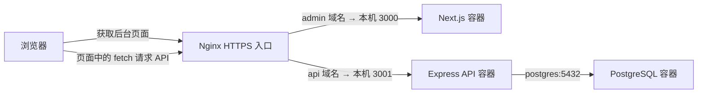

# 08. 把本地原理带到线上排错

本地已经能打开页面、读写文章，为什么部署以后还会出现页面能开但 API 失败、API 能通但登录失败、健康检查正常但文章查不出？

上线增加了参与者和配置边界。先画清请求经过谁，再对每一段找证据。

## 1. 页面请求与 API 请求是两条路

以下按 MiniCMS 已有的宝塔 Nginx + Compose 方案解释，域名仅为示意：



浏览器先取得页面和 JavaScript，页面交互再发起 API 请求。当前方案中，文章请求不必穿过 Next.js 服务端。

这也解释了“页面能开、文章加载失败”：拿页面成功只证明了其中一条路径，不能证明 API 地址、API 证书、CORS 和数据库都正确。

## 2. 反向代理像一个统一接待处

Nginx 接收外部请求，根据域名和配置转交给内部服务。当前方案在 Nginx 处理公网 HTTPS，再通过 HTTP 访问宿主机映射出的应用端口。

```text
浏览器与 Nginx：一段连接，通常使用 HTTPS
Nginx 与应用：另一段连接，当前配置使用本机 HTTP 上游
Express 与 PostgreSQL：数据库连接
```

它不是把浏览器原来的 TCP 连接原封不动延长到数据库。代理作为服务端接请求，又作为客户端请求上游，最后把结果返回浏览器。[Nginx HTTP 代理模块](https://nginx.org/en/docs/http/ngx_http_proxy_module.html)

接待处正常开门，也可能联系不上后面的办事窗口。收到 502 时，应该先看代理能否取得有效上游响应；不能因为有一个 HTTP 错误页面，就认定 Express 的业务函数已经运行。

## 3. localhost 到底是谁自己

把这个问题固定成习惯：这条请求从哪里发出？

| 发起位置 | 此处的 localhost / 127.0.0.1 指向 |
|---|---|
| 你的 Mac 终端或 Mac 浏览器 | 你的 Mac |
| SSH 登录后的云服务器终端 | 云服务器宿主机 |
| API 容器内部 | API 容器自己的网络环境 |
| PostgreSQL 容器内部 | PostgreSQL 容器自己的网络环境 |

当前使用 Compose 默认网络，每个容器有自己的网络环境。API 在容器里访问 `localhost:5432`，会去找自己，不会自动跳到 PostgreSQL 容器。

同一个 Compose 网络里的服务可以用服务名找到彼此，所以数据库主机使用 `postgres`、端口使用容器内的 5432。[Compose 网络说明](https://docs.docker.com/compose/how-tos/networking/)

这个服务名只在相应 Docker 网络中有意义。浏览器在你的电脑上，不能照抄 `http://api:3001` 作为公开 API 地址。

## 4. 三段式端口映射怎样读

项目生产 Compose 中，API 使用：

```yaml
ports:
  - "127.0.0.1:3001:3001"
```

从左到右是宿主机监听地址、宿主机端口、容器端口。把它看成大楼接待处到内部窗口的一条转接线路：

```text
宿主机 127.0.0.1:3001 → API 容器的 3001
```

宝塔 Nginx 运行在宿主机，因而能访问这个本机入口；外部浏览器访问公网 HTTPS 域名，由 Nginx 转交。容器内的 Node.js 还必须监听能接收容器网络流量的地址，如果只监听容器内的 `127.0.0.1`，端口映射也不能替它接收来自容器外的连接。

API 访问 `postgres:5432` 走内部网络，不必绕到宿主机映射端口。数据库在宿主机映射 5432 的用途可以是 TablePro 的 SSH 隧道访问，与容器间通信是两条路。

MiniCMS 根目录的 `compose.yaml` 用于本地开发，只启动 PostgreSQL；`deploy/docker-compose.yml` 才是这里解释的生产运行配置。检查前先确认自己读的是哪一份。

## 5. 地址错误也可能发生在构建时

API 容器运行时取得 `DATABASE_URL`、`ADMIN_WEB_ORIGIN` 等环境变量；管理端浏览器代码里的 `NEXT_PUBLIC_API_BASE_URL` 则在构建时写入。

因此“我已经改了服务器 .env”不足以证明前端地址已改。先在浏览器 Network 中看实际请求 URL，再按第 02 章追到地址进入构建的时机。

Compose 的 `.env` 也不会整份自动成为所有容器的环境变量。当前文件中，哪些变量出现在 `environment`、哪些用来填镜像名、哪些传入构建参数，需要分别看引用位置。已有完整配置回顾见 [20C](../backend-system-learning/20C-Docker-Compose部署链路回顾.md)。

## 6. 按证据缩小范围

每个现象只证明一部分事实：

| 现象 | 可以先确认什么 | 下一步证据 |
|---|---|---|
| 域名解析失败 | 还没正常找到目标地址 | DNS 记录、本地解析结果 |
| 证书校验失败 | 安全连接校验没有通过 | 实际域名、证书、连接目标 |
| Connection refused | 目标连接被拒绝 | 请求位置、IP、端口、监听状态 |
| 连接或请求超时 | 规定时间内未完成某一步 | 连接阶段、代理日志、应用日志；别直接归因于数据库 |
| 502 | 代理未取得有效的上游响应等 | Nginx 错误日志、上游地址、应用运行状态 |
| 504 | 网关等待上游超时 | 应用处理、数据库等待、阻塞或网络情况 |
| 404 | 收到了某个 HTTP 服务的“未找到”响应 | 是否命中预期服务、路径是否被改写、路由是否存在 |
| 401 | 返回该状态的应用未认可身份 | Cookie 是否携带、Session 是否有效 |
| 422 | 应用拒绝了输入或相应业务条件 | 响应错误码、字段详情、提交内容 |
| CORS 错误 | 浏览器跨来源访问未满足要求 | OPTIONS、Origin、响应头、凭证配置 |
| 500 | 应用或代理产生内部错误响应 | 根据响应内容与相应服务日志确认来源 |

这张表给出检查方向，不把错误码当成唯一病因。比如代理把路径转错，也可能得到 Express 的 404；浏览器显示 CORS 错误，也可能是上游失败响应缺少预期 CORS 头。

## 7. 用两个接口区分“进程活着”和“业务能用”

在本地 MiniCMS 正常启动时执行：

```bash
curl -i http://localhost:3001/api/health
curl -i http://localhost:3001/api/public/articles
```

当前健康检查只返回固定 JSON，响应中有 `articleService`。它证明服务能处理这个简单 HTTP 请求，没有查询数据库。

公开文章列表会进入 repository 并查询 PostgreSQL。返回 200 且 `data` 为空数组，也可以是正常结果，表示当前没有符合公开条件的文章。

如果第一条成功、第二条失败，继续看第二条的错误和后端日志，重点检查查询链路；不能直接宣布数据库正常，也不能只凭差异认定一定是数据库连接错误，因为参数或应用代码同样可能失败。

这一对检查无需管理员 Cookie，也不写入数据，适合初步缩小故障范围。

## 8. 已有服务器时怎样逐段检查

下面命令只用于你已按 20A 部署的服务器。通过原有 SSH 方式登录后，进入实际项目目录；20A 默认是 `/opt/mini-cms`：

```bash
cd /opt/mini-cms
docker compose --env-file deploy/.env -f deploy/docker-compose.yml ps
docker compose --env-file deploy/.env -f deploy/docker-compose.yml logs --tail=80 api
curl -i http://127.0.0.1:3001/api/health
curl -i http://127.0.0.1:3001/api/public/articles
```

这些检查分别看容器状态、API 日志、宿主机到 API 的简单链路，以及访问数据库的业务链路。

容器显示 running，只说明主进程仍在运行；不等于服务已经开始监听。当前 API 启动命令先执行迁移，再启动服务，迁移失败或尚未结束时，状态与端口就需要结合日志判断。

最后回到你的 Mac，替换示例域名，检查公网入口：

```bash
API_HOST=api.example.com
curl -i "https://${API_HOST}/api/public/articles"
```

如果服务器本机请求成功、公网请求失败，继续查 DNS、HTTPS、Nginx 与外部网络；如果公网 curl 成功、浏览器失败，再看浏览器实际 URL、CORS 和 Cookie。把“请求从哪里发出”记在每条观察旁边。

没有线上环境时，先完成上一节本地检查。这一章不要求重新部署，完整部署操作仍由 [20A](../backend-system-learning/20A-用宝塔和Docker-Compose部署MiniCMS.md)负责。

## 9. 怎样把这些基础用于架构判断

现在可以让选择从具体机制出发：

- 数据库等待多，先观察查询、连接池与数据库容量。增加 Node.js 进程也会增加潜在数据库连接，不能只看 API 实例数量。
- 同步计算挡住其他请求，先确认耗时位置，再考虑拆分计算、工作线程或独立任务；单纯加 async 没有改变计算所在的线程。
- 需要运行多份 API 时，当前数据库 Session 能让实例通过同一个数据库核验登录；实例还必须使用一致的配置与规则。仅存在单个进程内的登录状态不会自动共享。
- 后台页面能开但数据请求失败，先验证独立的 API 路径。没有证据时，不需要为了“更稳”马上增加更多服务层。

这些是根据当前机制进行的推理，不代表 MiniCMS 已经实现了多实例、任务队列或工作线程。

## 10. 最后做一次完整费曼复述

假设朋友会写 JavaScript，但没做过完整 Web 项目。用五分钟解释：

> 我在 MiniCMS 后台查看文章列表，从启动项目到页面出现文章，这中间发生了什么？如果文章加载不出来，我怎样找第一条线索？

讲述中至少串起：

```text
npm 脚本与 Node.js 进程
→ 浏览器和服务器各运行哪些代码
→ 地址、连接与 HTTP 请求
→ Cookie 与来源规则
→ Express 的处理顺序
→ PostgreSQL 查询与 await
→ JSON 响应与页面更新
→ 上线后的代理和容器边界
```

然后改变一个条件重新解释：API 地址写成了 localhost、Cookie 没有带上、数据库查询慢、路由加入了大量同步计算。你应当能预测现象，并指出准备看哪个证据，而不是从头背一遍术语。

可用下面四行记录自己的复述缺口：

```text
我最初的解释：
哪个现象与解释冲突：
我查到的代码或实验结果：
我修正后的解释：
```

需要继续深入操作系统时，回到 [Linux 第 06 章](../../linux/06-进程服务日志与端口.md)、[第 08 章](../../linux/08-云服务器网络安全组与防火墙.md)和[第 09 章](../../linux/09-Docker与Linux-容器不是云服务器.md)。需要重走某个业务功能时，回到[后端学习路线](../backend-system-learning/README.md)。
