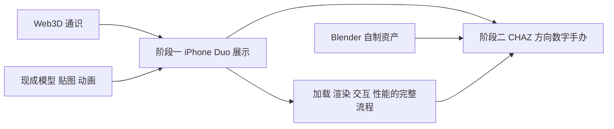

# Web3D 学习路线：从开发流程到可交互的产品展示

这套路线面向有 Blender 基础、试过 Three.js，但还没把资产、材质、灯光和网页交互串起来的你。

**先建立 Web3D 通识，再以 iPhone Duo 展示做第一阶段实践；CHAZ 数字手办放到第二阶段。** 第一阶段直接接收现成模型，把精力放在开发流程和操作手感；第二阶段再把自己的 Blender 资产放进同一条流程。

技术主线保留：**glTF / GLB → Three.js → React Three Fiber（R3F）+ Drei → Next.js**。Blender 负责资产制作与修改，Next.js 负责网站，画面质量由模型、材质、灯光、色彩和镜头共同决定。

## 现在从哪里开始

1. 读 [01-目标效果与工具选择](./01-目标效果与工具选择.md)，理解一帧画面和一条交互是怎么产生的。
2. 进入 [第一阶段：iPhone Duo 3D 展示](./projects/01-iphone-duo/README.md)，运行已有学习基线，再分步改动。
3. 遇到材质问题查 [04-材质灯光与色彩校准](./04-材质灯光与色彩校准.md)；需要把变量隔离时再做 [03-Nextjs材质实验台](./03-Nextjs材质实验台.md)。
4. 第一阶段完成后，进入 [第二阶段：CHAZ 方向数字手办](./projects/02-chaz-digital-toy/README.md)。

不必先读完所有章节，也不用先重新做一台手机。React 组件、`useState`、`useRef` 是当前前置；有疑问时回看 [前端体系入口](../frontend-system-learning/README.md)。

## 两个阶段分别交付什么

| 阶段 | 目标 | 学会的证据 |
|---|---|---|
| 第一阶段：产品展示 | 接近 iPhone Duo 展示的材质表现、姿态切换和跟手旋转 | 能解释文件到画面、按钮到动画、指针到旋转三条链；有视觉对照与真机记录 |
| 第二阶段：可玩物件 | CHAZ 方向的一台自制数字手办 | 自己完成 Blender 交付、屏幕与按键、机械结构，再扩展为展示网站 |

第一阶段已有模型接入和可运行代码，但还需要继续校准视觉与手感。第二阶段目前是学习任务和示例，不是已经完成的成品。达到参考作品的完成度，要以实际对照和设备测试判断。

## 通识与查阅目录

现有内容保留为知识底座；章节编号不再代表必须依次完成的关卡。

| 文档 | 什么时候读 |
|---|---|
| [01-目标效果与工具选择](./01-目标效果与工具选择.md) | 开始前：工具职责、基本概念、开发流程 |
| [02-Blender到网页的资产流程](./02-Blender到网页的资产流程.md) | 需要修改或自制模型时；第二阶段重点 |
| [03-Nextjs材质实验台](./03-Nextjs材质实验台.md) | 不确定问题出在模型还是网页时，做独立对照实验 |
| [04-材质灯光与色彩校准](./04-材质灯光与色彩校准.md) | 两个阶段都用：贴图、环境反射和颜色排错 |
| [05-按键屏幕与机械交互](./05-按键屏幕与机械交互.md) | 第二阶段：从展示扩展到可玩的物件 |
| [06-数字手办项目与验收](./06-数字手办项目与验收.md) | 第二阶段：把单件作品交付成网站 |
| [07-学习资料与排错速查](./07-学习资料与排错速查.md) | 按当前问题查资料 |

第一阶段项目附有源码和资产交接说明；素材制作工具独立于工程。Apple 资产在本地交付目录中，不纳入 Git；新克隆仓库需要按项目 README 单独准备完整资产目录。独立的 `projects/phone-lab/` 仍是第 03 章由你创建的实验，不要与现有 iPhone 项目混在一起。

路线更新：2026-11-26。当前学习基线采用 Next.js 16、React 19、R3F 9、Drei 10 和 WebGL；具体版本见项目锁文件。
