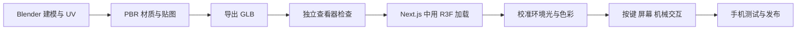

# Web3D 学习路线：从 Blender 到可交互的产品展示

这套路线面向已经会一点 Blender、玩过 Three.js，但导出到网页后总觉得材质不对的你。

目标是独立做出一件接近 CHAZ 手机博物馆方向的作品：模型经得起近看，塑料、金属和屏幕能分清，旋转时反射自然，并且能开机、按键、翻盖。最终完成一台自己的数字手办，再扩展成小型展示网站。

推荐主线是 **Blender + glTF/GLB + Three.js + React Three Fiber + Drei + Next.js**。其中，Next.js 组织网站，R3F 组织 3D 组件；画面质量要靠模型、材质、灯光、色彩和镜头共同建立。

## 从哪里开始

你不需要重学整套前端，也不需要先学完 Shader。先确认自己能写 React 组件、`useState` 和 `useRef`；对 Next.js 还不熟时，回看仓库的 [前端体系入口](../frontend-system-learning/README.md) 和 [网站练习入口](../frontend-website-lab/README.md)。

| 顺序 | 文档 | 动手后的结果 |
|---|---|---|
| 1 | [01-目标效果与工具选择](./01-目标效果与工具选择.md) | 知道参考作品要拆成哪些能力，确定工具主线 |
| 2 | [02-Blender到网页的资产流程](./02-Blender到网页的资产流程.md) | 导出材质和结构可检查的 `phone.glb` |
| 3 | [03-Nextjs材质实验台](./03-Nextjs材质实验台.md) | 跑起网页实验台，再加载自己的 GLB |
| 4 | [04-材质灯光与色彩校准](./04-材质灯光与色彩校准.md) | 找到 Blender 与网页差异的具体来源 |
| 5 | [05-按键屏幕与机械交互](./05-按键屏幕与机械交互.md) | 让按键改变屏幕，让部件绕正确的轴运动 |
| 6 | [06-数字手办项目与验收](./06-数字手办项目与验收.md) | 做完单件作品，经过真机测试，再扩展展示页 |
| 查阅 | [07-学习资料与排错速查](./07-学习资料与排错速查.md) | 按当前问题查官方资料，不无目的刷教程 |

可以先读 01，再用 03 的无模型实验跑起来，然后回到 02 做资产。这能尽早分清：问题来自导出的模型，还是网页里的环境。

## 每一阶段怎么判断学会了

| 阶段 | 交付物 | 进入下一阶段的条件 |
|---|---|---|
| 材质实验 | 同一灯光下的塑料、金属、屏幕样片 | 能解释金属为什么需要环境反射，粗糙度改变了什么 |
| 资产迁移 | `.blend` 源文件、GLB、贴图、导出记录 | UV、法线、材质分区正确；查看器和网页均能打开 |
| 视觉完成 | 正面、侧面、背面、近景四张网页截图 | 不靠高强度 Bloom 遮掩问题；主要材质稳定可辨 |
| 可玩手办 | 一台可旋转、开关屏幕、操作一个机械部件的设备 | 转动、点击和动画不会互相抢控制权 |
| 网站完成 | 单件详情页、静态预览和移动端记录 | 加载与失败有反馈，真机可操作，性能达到自己设定的预算 |

把学习时间更多留给「对照截图、只改一个变量、解释差异」。能加载模型只是第一步；读完文档并不等于已经达到参考作品的完成度。

## 文档与练习代码的边界

本目录目前提供学习文档与可复制示例。`projects/phone-lab/` 是你跟随第 03 章创建的练习项目，尚未附带成品网站、手机模型或原站资产。第 06 章是后续项目任务和验收，不表示这些功能已经完成。

技术资料核对日期：2026-11-25。代码主线采用 React 19、R3F 9、Drei 10 和 WebGL 渲染路径；升级大版本时重新检查兼容性。版本与命令见第 03 章。
